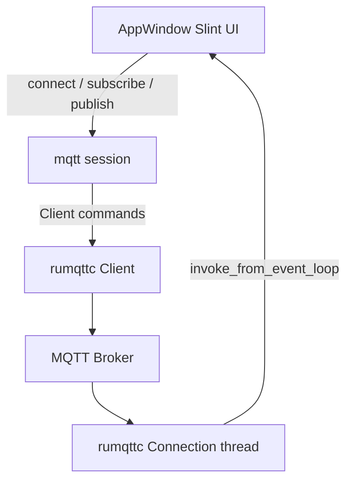

# 架构设计

## 系统概述

mqttc 采用「Slint 主线程 UI + 后台 MQTT 会话线程」结构。UI 只负责展示与发起命令；rumqttc 的 `Client` 发送订阅/发布，`Connection` 在独立线程轮询事件并回写界面。

## 技术栈

- Rust 2021 edition
- Slint（`slint` + `slint-build`）
- rumqttc 同步客户端（MQTT 3.1.1）
- 标准库通道与线程，MVP 不引入异步运行时

## 项目结构（建议）

```
mqttc/
├── Cargo.toml
├── build.rs
├── ui/
│   └── app-window.slint
└── src/
    ├── main.rs
    └── mqtt.rs
```

## 核心模块/组件

- **UI 层** (`ui/app-window.slint`): 连接参数、订阅/发布表单、状态与日志列表
- **应用入口** (`src/main.rs`): 创建窗口、绑定回调、持有日志模型
- **MQTT 会话** (`src/mqtt.rs`): 连接生命周期、订阅、发布、事件翻译

## 架构图



## 关键流程

1. 用户点击连接：主线程按 host/port/client-id 创建 `Client` 与 `Connection`，启动轮询线程。
2. `ConnAck` 到达后，通过 `slint::invoke_from_event_loop` 将状态设为已连接。
3. 订阅/发布在主线程调用 `Client` 方法，由内部通道交给事件循环发出。
4. 收到 `Publish` 后追加一条日志；连接错误则回到未连接并记录原因。
5. 断开时调用 `disconnect`，轮询线程退出。

## 设计决策

- **同步 rumqttc**: 与 Slint 主线程模型匹配，避免再嵌一套 tokio 运行时。
- **事件回写必须走 invoke_from_event_loop**: Slint 组件只能在创建它的线程上访问。
- **MVP 仅 TCP + QoS 0**: 先打通日常调试路径，TLS、账号密码、MQTT 5 后续迭代。
- **同一套源码三平台**: Windows 为功能基线，macOS/Linux 复用，差异仅在打包。
