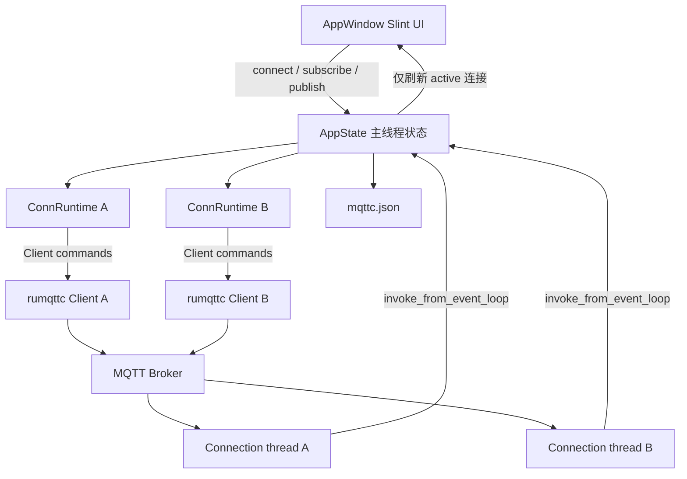

# 架构设计

## 系统概述

mqttc 采用「Slint 主线程 UI + 后台 MQTT 会话线程」结构。UI 只负责展示与发起命令；rumqttc 的 `Client` 发送订阅/发布，`Connection` 在独立线程轮询事件并回写界面。

## 技术栈

- Rust 2021 edition
- Slint（`slint` + `slint-build`）
- rumqttc 同步客户端（MQTT 3.1.1）
- 标准库通道与线程，MVP 不引入异步运行时

## 项目结构（建议）

```
mqttc/
├── Cargo.toml
├── build.rs
├── ui/
│   └── app-window.slint
└── src/
    ├── main.rs
    ├── config.rs
    └── mqtt.rs
```

## 核心模块/组件

- **UI 层** (`ui/app-window.slint`): MQTTX 式多页布局。左侧连接列表常驻；`page=0` 为连接配置页，`page=1` 为会话页（订阅栏 + 聊天气泡 + 底部发布）
- **应用入口** (`src/main.rs`): 窗口创建、回调绑定、多连接运行时与状态刷新、Payload 编解码、日志筛选、定时发布
- **配置层** (`src/config.rs`): 多连接配置与界面偏好的读写、旧配置迁移
- **MQTT 会话** (`src/mqtt.rs`): 单连接生命周期、Keep Alive / Clean Session / 超时 / Last Will / TLS、订阅、取消订阅、发布、事件翻译

## 运行时状态

`AppState` 持有 `AppConfig`（持久化配置）与 `runtimes: HashMap<连接 id, ConnRuntime>`。每个 `ConnRuntime` 拥有独立的 `MqttHandle`、日志缓冲 `Vec<LogData>`、连接状态与定时发布代数，因此多个连接可同时在线、各自收发。定时发布按连接配置循环发送，切换界面查看其它连接时后台仍继续。

界面同一时刻只显示当前选中连接：`active_id` 指向的连接。后台事件到达时按连接 id 写入对应 runtime，命中当前连接才刷新界面。日志缓冲保留原始字节，切换接收格式时由原始字节重新渲染。

`AppState` 通过主线程 `thread_local` 暴露给回调与事件回写路径，因为 `Rc<RefCell<..>>` 无法跨线程传递给 `invoke_from_event_loop`。

## 架构图



## 关键流程

1. 启动：加载 `mqttc.json`，旧格式迁移为一条连接；为空则创建默认连接；为每条连接建立 `ConnRuntime`。
2. 新建进入配置页，点选已有连接进入会话页；切换前先把表单写回配置。删除时断开该连接的会话。
3. 用户点击连接：按该连接的 host/port/client-id/认证/Keep Alive/Clean Session/超时/Last Will/SSL 创建 `Client` 与 `Connection`，启动轮询线程。Client ID 为空时自动生成。连接成功后切到会话页。启用 SSL 时用 rustls，可校验系统/自定义 CA，也可关闭校验或附带客户端证书。
4. `ConnAck` 到达后标记为已连接，并按该连接的订阅列表自动重新订阅（Clean Session 下重连需要恢复订阅）。
5. 订阅/发布在主线程调用 `Client` 方法；发布前按所选格式把文本编码为字节。定时发布用独立线程按间隔回调主线程发送。
6. 收到 `Publish` 后按连接 id 写入日志缓冲；命中当前连接则按筛选条件重新渲染聊天气泡。
7. 断开时调用 `disconnect`，停止该连接的定时发布，轮询线程退出。

## 设计决策

- **同步 rumqttc**: 与 Slint 主线程模型匹配，避免再嵌一套 tokio 运行时。
- **事件回写必须走 invoke_from_event_loop**: Slint 组件只能在创建它的线程上访问。
- **每连接独立 runtime**: 支持多连接同时在线，互不干扰；界面只渲染当前选中连接。
- **日志保留原始字节**: 切换文本/JSON/Base64/Hex 显示时可无损重渲染。
- **配置与偏好同文件**: 单文件便于拷机使用，启动自动迁移旧格式。
- **同一套源码三平台**: Windows 为功能基线，macOS/Linux 复用，差异仅在打包。
