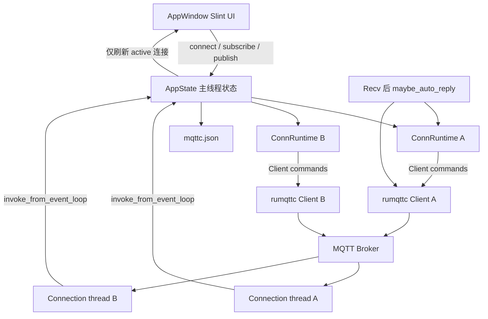

# 架构设计

面向维护者的精简说明。想按「先骨架、再细节」的顺序阅读源码，或第一次接触 Rust / Slint，请先看 当前工作区 `/.monkeycode/docs/ARCHITECTURE_GUIDE.md`。

## 系统概述

mqttc 采用「Slint 主线程 UI + 每连接独立 MQTT 工作线程」结构。UI 只负责展示与发起命令；rumqttc 的 `Client` 发送订阅/发布，事件循环在独立线程轮询并通过 `invoke_from_event_loop` 回写界面。图形后端固定为 `winit-software`，避免 FemtoVG/OpenGL 在启动时多占约 100 MB。

## 技术栈

- Rust 2021 edition，release 开启 thin LTO、单 codegen unit、strip
- Slint 1.18（`std`、`backend-winit`、`renderer-software`、`compat-1-2`）
- rumqttc 0.24 同步客户端（MQTT 3.1.1 与 5.0），TLS 走 rustls
- 标准库通道与线程，不引入异步运行时

## 项目结构

```
mqttc/
├── Cargo.toml
├── build.rs
├── README.md
├── assets/icon.png
├── dist/
│   ├── mqttc.exe
│   └── mqttc-linux-amd64
├── scripts/package-macos.sh
├── ui/app-window.slint
└── src/
    ├── main.rs
    ├── config.rs
    ├── mqtt.rs
    └── i18n.rs
```

## 核心模块/组件

- **UI 层** (`ui/app-window.slint`): MQTTX 式多页布局。左侧连接列表常驻；`page=0` 连接配置，`page=1` 会话（订阅栏 + 聊天气泡 + 底部发布 + 预设发送按钮），`page=2` 设置，`page=3` 自动回复，`page=4` 发布预设，`page=5` 关于
- **应用入口** (`src/main.rs`): 窗口创建、回调绑定、多连接运行时、Payload 编解码、日志筛选、定时发布、自动回复匹配与发送、发布预设增删
- **配置层** (`src/config.rs`): 多连接配置与界面偏好的读写、旧配置迁移、发布预设与自动回复字段规范化
- **MQTT 会话** (`src/mqtt.rs`): 单连接生命周期、协议版本、Keep Alive / Clean Session / 超时 / Last Will / TLS、订阅、取消订阅、发布、事件翻译
- **界面语言** (`src/i18n.rs`): 进程级中/英切换，工作线程通过原子变量读当前语言

## 运行时状态

`AppState` 持有 `AppConfig`（持久化配置）与 `runtimes: HashMap<连接 id, ConnRuntime>`。每个 `ConnRuntime` 拥有独立的 `MqttHandle`、日志缓冲 `Vec<LogData>`（上限 200）、连接状态、定时发布代数，以及 `last_auto_reply`（最近一次自动回复的 Topic 与原始字节，供自身回投判断）。多个连接可同时在线、各自收发。定时发布按连接配置循环发送，切换界面查看其它连接时后台仍继续。

界面同一时刻只显示当前选中连接：`active_id` 指向的连接。后台事件到达时按连接 id 写入对应 runtime，命中当前连接才刷新界面。日志缓冲保留原始字节，切换接收格式时由原始字节重新渲染。

`AppState` 通过主线程 `thread_local` 暴露给回调与事件回写路径，因为 `Rc<RefCell<..>>` 无法跨线程传递给 `invoke_from_event_loop`。

## 架构图



## 关键流程

1. 启动：加载 `mqttc.json`，旧格式迁移为一条连接；为空则创建默认连接；为每条连接建立 `ConnRuntime`。缺发布预设或自动回复字段视为空列表；自身回投缺省为 skip。
2. 新建进入配置页，点选已有连接进入会话页；切换前先把表单（含预设与自动回复）写回配置。删除时断开该连接的会话并丢掉 runtime。
3. 用户点击连接：按该连接的 host/port/client-id/认证/协议/Keep Alive/Clean Session/超时/Last Will/SSL 创建 `Client` 与事件循环，启动轮询线程。Client ID 为空时自动生成。连接成功后切到会话页，并清空 `last_auto_reply`。启用 SSL 时用 rustls，可校验系统/自定义 CA，也可关闭校验或附带客户端证书。
4. `ConnAck` 到达后标记为已连接，并按该连接的订阅列表自动重新订阅（Clean Session 下重连需要恢复订阅）。
5. 订阅/发布在主线程调用 `Client` 方法；发布前按所选格式把文本编码为字节。底部「发布」与定时发布读表单；会话页预设发送按钮读对应预设，不改表单。定时发布用独立线程按间隔回调主线程发送。预设的增删与字段编辑在页 4 完成。
6. 收到 `Publish` 后按连接 id 先写 RECV 日志，再在 UI 线程跑 `maybe_auto_reply`：若页 3 可见且是当前连接则先 `sync_form`；skip 且自身回投则结束；否则按列表选第一条已勾选命中规则，编码并 `MqttHandle.publish`，成功则记 SEND 并更新 `last_auto_reply`。
7. 断开时调用 `disconnect`，停止该连接的定时发布，清空 `last_auto_reply`，轮询线程退出。窗口退出前再 `sync_form` / `sync_prefs` 并写入 `mqttc.json`。

## 设计决策

- **同步 rumqttc**: 与 Slint 主线程模型匹配，避免再嵌一套 tokio 运行时。
- **事件回写必须走 invoke_from_event_loop**: Slint 组件只能在创建它的线程上访问。
- **每连接独立 runtime**: 支持多连接同时在线，互不干扰；界面只渲染当前选中连接。
- **日志保留原始字节**: 切换文本/JSON/Base64/Hex 显示时可无损重渲染。
- **自动回复评估在记完 RECV 之后**: 与工作线程解耦；规则字段来自当前连接配置，不读底部表单与发布预设。
- **自身回投只认最近一次 Fixed Reply**: 手动发布、预设、定时发布不写入 `last_auto_reply`。
- **软件渲染 + thin LTO**: 控制启动内存与发布体积。
- **配置与偏好同文件**: 单文件便于拷机使用，启动自动迁移旧格式。
- **同一套源码三平台**: Windows 与 Linux 提供预编译产物，macOS 须在本机编译打包。
