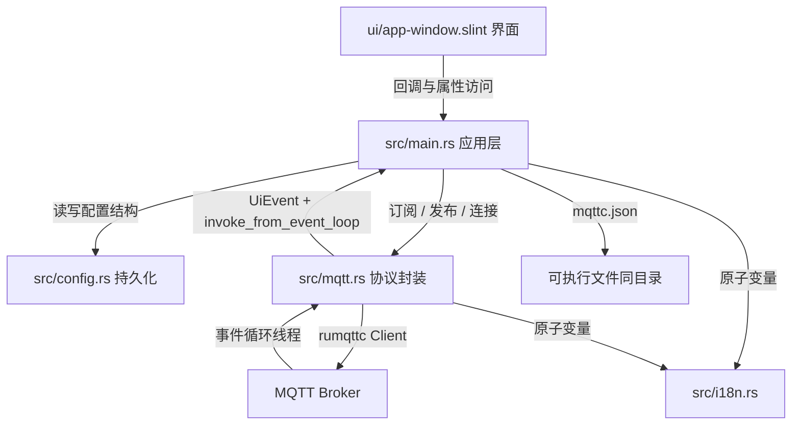
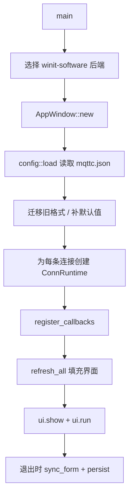
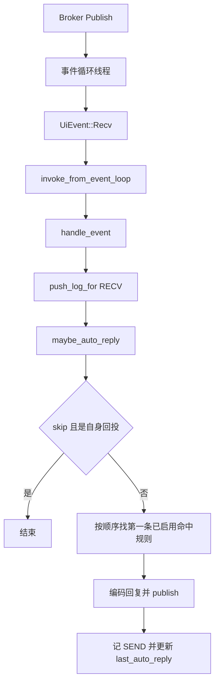

# 架构与源码导读

这份文档面向两类读者：

- 想确认 mqttc 已实现哪些能力、内部如何组织的使用者
- 刚学完 Rust 基础语法，第一次阅读桌面 GUI 项目，或第一次接触 Slint 的开发者

读完后你应该能回答三个问题：

1. 界面上的一个操作，最终改动了哪份数据
2. MQTT 消息从 Broker 到达界面，中间经过了哪些线程
3. 想新增一个字段、一个页面或一种 Payload 格式，应该改哪些文件

维护者视角的精简设计说明见 [架构设计](ARCHITECTURE.md)。属性、回调与 `mqttc.json` 字段对照见 [接口定义](INTERFACES.md)。

## 一分钟认识项目

mqttc 是一个桌面 MQTT 调试客户端。界面与交互参考 MQTTX。MQTTX 很好用。发起本项目，是为了得到一份拷贝即可运行、体积和内存占用更小的客户端。它有四个 Rust 源文件和一份 Slint 界面文件，没有 Web 服务、没有数据库、没有异步运行时。

| 层 | 文件 | 职责 |
|----|------|------|
| 界面 | `ui/app-window.slint` | 布局、主题、双语文案、用户操作回调 |
| 应用逻辑 | `src/main.rs` | 状态管理、回调处理、编解码、日志、自动回复、定时发布 |
| 协议 | `src/mqtt.rs` | 建立连接、订阅、发布、把 rumqttc 事件翻译成应用事件 |
| 持久化 | `src/config.rs` | 配置结构、JSON 读写、旧格式迁移、字段规范化 |
| 文案 | `src/i18n.rs` | 进程级中英文切换，供主线程与工作线程共同读取 |

三个核心设计：

- UI 用 Slint 声明式描述，Rust 只负责修改属性与响应回调
- 全部可变业务状态集中在主线程的 `AppState`
- 每条连接拥有独立的 MQTT 事件循环线程，事件通过 `invoke_from_event_loop` 回到主线程

## 读代码前需要知道的 MQTT 概念

| 概念 | 含义 | 在本项目中的位置 |
|------|------|------------------|
| Broker | 消息服务器，客户端连上它收发消息 | 连接配置页的 host / port |
| Client ID | 客户端标识，同一 Broker 上应唯一 | 留空时 `default_client_id` 自动生成 |
| Topic | 消息主题，用 `/` 分层 | 订阅栏、发布栏、预设、自动回复 |
| 通配符 | `+` 匹配一层，`#` 匹配多层 | `topic_matches_filter` 实现筛选与规则匹配 |
| QoS | 投递质量 0/1/2 | 订阅、发布、预设、自动回复都可选 |
| Retain | Broker 保留最后一条消息，新订阅者立即收到 | 发布栏与规则里的 Retain 开关 |
| Clean Session | 连接时不恢复旧会话；MQTT 5.0 称 Clean Start | 配置页勾选项 |
| Keep Alive | 心跳间隔秒数 | 配置页，3.1.1 最小 1 秒，5.0 最小 5 秒 |
| Last Will | 异常断开时由 Broker 代发的遗嘱消息 | 配置页高级参数 |
| TLS | 加密传输，可选校验证书 | 勾选 SSL 后走 rustls |

## 读代码前需要知道的 Slint 概念

Slint 用 `.slint` 文件描述界面，编译期由 `build.rs` 转成 Rust 代码。本项目用到的语法只有以下几类。

### 1. 文件里有什么

`ui/app-window.slint` 的组织顺序：

| 位置 | 内容 |
|------|------|
| 第 3 到 42 行 | `struct`：界面用的数据结构，如 `ConnectionEntry`、`LogEntry` |
| 第 46 到 94 行 | `global Theme`：全部配色，按皮肤索引取色 |
| 第 96 到 105 行 | `global I18n`：双语文案函数 `t(zh, en)` |
| 第 107 到 195 行 | 可复用小组件 `Select`、`FieldLabel` |
| 第 197 到 379 行 | `MessageList`：聊天气泡与滚动逻辑 |
| 第 380 行起 | `AppWindow`：窗口属性、回调与六个页面 |

### 2. 属性与方向

```slint
in property <string> caption;          // 外部只读传入
in-out property <int> page: 0;         // 双向可读写
out property <color> window-bg: ...;   // 只由内部计算得出
```

`AppWindow` 上声明了界面需要的全部属性，例如 `host`、`pub-topic`、`logs`。Rust 侧通过生成的访问器读写它们：

- `ui.get_host()` / `ui.set_host(...)`
- `ui.get_pub_topic()` / `ui.set_pub_topic(...)`
- 回调 `connect-requested` 对应 `ui.on_connect_requested(...)`
- 属性名中的 `-` 在 Rust 访问器里变成 `_`

### 3. 绑定表达式

Slint 的属性可以直接写表达式，值变化时自动重算：

```slint
height: 100%;
background: Theme.panel-bg;
enabled: root.connected;
```

`Theme.pick(black, white, blue, green, purple)` 是纯函数，用当前皮肤索引选择一套配色。新增皮肤时需要同时扩展 `Skin` 枚举与 `pick` 的参数。

### 4. 回调与事件

`.slint` 里声明 callback，用户操作处调用它：

```slint
callback connect-requested();
clicked => { root.connect-requested(); }
```

Rust 侧在 `register_callbacks` 中注册闭包。所有回调都在 UI 线程执行，闭包通过 `ui.as_weak()` 获取窗口的弱引用，避免循环引用。

### 5. 列表与模型

重复渲染用 `for`，数据来自数组属性：

```slint
for entry[index] in root.connections: Rectangle { ... }
```

Rust 侧用 `VecModel` 传给界面：

```rust
ui.set_connections(Rc::new(VecModel::from(entries)).into());
```

每次刷新都会构造一个新的 `VecModel`。本项目日志上限 200 条、连接数量较少，这个成本可以接受。

### 6. 双向绑定

```slint
in-out property <int> skin <=> Theme.skin;
in-out property <int> language <=> I18n.language;
```

`<=>` 让窗口属性与全局属性保持同步。改一处，另一处立即跟随。

### 7. 自定义组件

`Select` 是一个下拉选择组件，展示了组件最常用的写法：

```slint
component Select inherits Rectangle {
    in property <[string]> options: [];
    in-out property <int> current-index: 0;
    callback activated(int);
}
```

组件内部用 `TouchArea` 处理点击，用 `if` 控制弹出层显示。阅读页面代码时，遇到 `Select { options: [...]; current-index: ...; }` 就把它当成一个带回调的原生下拉框。

## 目录与职责

```text
mqttc/
├── Cargo.toml          # 依赖与 Slint 特性：std、backend-winit、renderer-software、compat-1-2
├── build.rs            # slint_build::compile("ui/app-window.slint")；Windows 图标与链接参数
├── ui/app-window.slint # 全部界面
├── src/
│   ├── main.rs         # 2711 行，应用层，下面再细分
│   ├── mqtt.rs         # 733 行，协议层
│   ├── config.rs       # 673 行，持久化层
│   └── i18n.rs         # 93 行，语言开关
├── assets/             # icon.png / icon.ico / windows.rc
├── scripts/            # macOS 打包、图标生成
├── dist/               # 本机构建产物，发布包见 GitHub Releases
└── .monkeycode/docs/   # 文档
```

`src/main.rs` 内部按出现顺序大致分为：

| 区域 | 内容 |
|------|------|
| 1 到 350 行 | 常量、`PayloadFormat`、`Skin`、`ConnStatus`、`LogData`、`ConnRuntime`、`AppState`、`with_state` |
| 351 到 424 行 | `main`：选择后端、加载配置、创建状态、注册回调、进入事件循环 |
| 425 到 1190 行 | `register_callbacks`：所有用户操作 |
| 1191 到 1322 行 | `handle_event` 与日志写入 |
| 1324 到 1655 行 | 字体、皮肤、Windows/macOS/Linux 深浅色与标题栏 |
| 1656 到 1918 行 | `show_page`、`refresh_*`、`sync_*` |
| 1919 到 2110 行 | 自动回复匹配与发布入口 |
| 2111 到 2450 行 | 发布实现、定时解析、`persist`、编解码、日志筛选与导出 |
| 2457 行以后 | `#[cfg(test)]` 单元测试 |

## 分层与依赖方向



依赖是单向的：界面不知道协议细节，协议层不知道界面存在，配置层不依赖前两者。`main.rs` 是唯一的协调者。

## 运行时对象

### AppState

```rust
struct AppState {
    config: AppConfig,
    runtimes: HashMap<String, ConnRuntime>,
    startup_error: Option<String>,
}
```

- `config`：要持久化的内容，启动时从 `mqttc.json` 读入，退出或关键操作后写回
- `runtimes`：只在内存中存在，键为连接 id。保存每个连接的活动客户端、日志与临时状态
- `startup_error`：加载配置失败时暂存错误，启动后写入日志

### ConnRuntime

```rust
struct ConnRuntime {
    mqtt: MqttHandle,
    logs: Vec<LogData>,
    status: ConnStatus,
    timed_generation: Arc<AtomicU64>,
    timed_running: bool,
    active_sub_topic: String,
    last_auto_reply: Option<(String, Vec<u8>)>,
}
```

- `logs`：原始 Payload 以 `Vec<u8>` 保存，切换显示格式时可无损重渲染
- `timed_generation`：定时发布的取消令牌，数值变化后旧线程自行退出
- `last_auto_reply`：最近一次自动回复的 Topic 与字节，用于识别 Broker 回投

### MqttHandle

`MqttHandle` 是 UI 线程与工作线程共同持有的句柄：

```rust
struct MqttHandle {
    inner: Arc<Mutex<Inner>>,
}

struct Inner {
    generation: u64,
    client: Option<LiveClient>,
}
```

`connect` 和 `disconnect` 都会递增 `generation`。工作线程每轮检查自己捕获的代数，发现不一致就退出。这样旧连接不会在重连后继续向界面发事件。

### 状态放在三处

初学时最容易混淆的是「这个值到底在哪」。可以按下面的表理解：

| 数据 | 存放位置 | 生存期 | 典型写入者 |
|------|----------|--------|------------|
| 用户正在输入的内容、界面显示内容 | Slint 属性 | 窗口存在期间 | `refresh_*` 写入，用户操作修改 |
| 已保存的连接、预设、规则、偏好 | `AppState.config` | 进程 + 磁盘 | `sync_*` 写入，`persist` 落盘 |
| 连接状态、日志、定时任务、回投记录 | `ConnRuntime` | 进程 | 回调与 `handle_event` |
| 当前界面语言 | `i18n::LANG` 原子变量 | 进程 | 设置页切换 |
| MQTT 客户端与代数 | `MqttHandle.inner` | 连接期间 | `src/mqtt.rs` |

同步方向是固定的：

- `refresh_*`：`config` / `runtime` → Slint 属性，用于切换连接或事件到达后重绘
- `sync_form` / `sync_prefs` / `sync_publish_presets` / `sync_auto_reply`：Slint 属性 → `config`，用于离开页面前收集用户输入
- `persist`：`config` → `mqttc.json`

切换连接、连接 Broker、退出程序前都会先 `sync_form`，避免把未保存的输入丢掉。

## 线程模型

### 线程一览

| 线程 | 数量 | 做什么 |
|------|------|--------|
| UI 主线程 | 1 | 运行 Slint 事件循环、执行回调、持有 `AppState`、刷新界面 |
| MQTT 事件循环线程 | 每连接 1 条 | 阻塞读取 Broker 事件，翻译成 `UiEvent` 后投递回主线程 |
| 定时发布线程 | 每个运行中的定时任务 1 条 | 按间隔睡眠，到点投递一次发布请求 |
| 系统皮肤轮询线程 | 1 条 | 定期检查操作系统深浅色 |

### 为什么必须回到主线程

Slint 组件只能在创建它的线程访问，`AppWindow` 的句柄也不能跨线程传递。`AppState` 内部是 `Rc<RefCell<...>>`，本身不是 `Send`。

因此工作线程只做两件事：

1. 通过 `MqttHandle` 调用线程安全的客户端方法
2. 把结果包装成 `UiEvent`，交给 `slint::invoke_from_event_loop`

```rust
mqtt.connect(params, move |event| {
    let ui_weak = ui_weak.clone();
    let conn_id = conn_id.clone();
    let _ = slint::invoke_from_event_loop(move || {
        if let Some(ui) = ui_weak.upgrade() {
            with_state(|st| handle_event(&ui, st, &conn_id, event));
        }
    });
});
```

### thread_local 的作用

```rust
thread_local! {
    static STATE: RefCell<Option<Rc<RefCell<AppState>>>> = RefCell::new(None);
}
```

`invoke_from_event_loop` 要求闭包满足 `Send + 'static`，而 `Rc<RefCell<AppState>>` 两者都不满足。解决办法是把状态放进 UI 线程的 `thread_local`，闭包里只捕获可以跨线程的 `Weak<AppWindow>` 和 `String`。

闭包在 UI 线程执行时，通过 `with_state` 取回同一份状态：

```rust
fn with_state<R>(f: impl FnOnce(&mut AppState) -> R) -> R {
    STATE.with(|slot| {
        let state = slot.borrow().clone().expect("application state is not initialized");
        f(&mut state.borrow_mut())
    })
}
```

### 取消旧任务

项目用两个原子计数器实现取消：

- `MqttHandle::inner.generation`：重连或断开后，旧 MQTT 线程退出
- `ConnRuntime::timed_generation`：停止定时发布后，旧定时线程退出

这种写法不需要复杂的同步原语，适合「任务只关心自己是否仍然有效」的场景。

### 共享的少量跨线程数据

| 数据 | 同步方式 | 原因 |
|------|----------|------|
| 当前语言 | `AtomicU8` | 工作线程生成 ConnAck 错误文案时需要读取 |
| MQTT 客户端 | `Arc<Mutex<Inner>>` | UI 线程发命令，工作线程持有事件循环 |
| 取消代数 | `AtomicU64` | 无锁读写即可判断任务是否过期 |

## 数据流

### 启动



关键点：连接不会在启动时自动建立，只创建运行时空壳。用户点击「连接」后才真正连 Broker。

### 连接 Broker

1. `on_connect_requested` 先 `sync_form` 收集表单
2. 校验主机、端口、Client ID，必要时生成 Client ID
3. 组装 `ConnectParams`，状态置为 `Connecting`
4. 调用 `MqttHandle::connect`，内部启动该连接的 rumqttc 事件循环线程
5. 收到 `ConnAck` 成功后发送 `UiEvent::Connected`
6. 主线程 `handle_event` 把状态改为 `Connected`、写 SYS 日志、按保存的订阅列表重新订阅、切到会话页

### 订阅

订阅操作本身很短：从表单读 Topic 与 QoS，写入 `config.subscriptions`，调用 `MqttHandle::subscribe`。重连后由 `resubscribe_all` 重放这份列表。

### 发布

发布有三个入口，底层都走 `MqttHandle::publish`，读数据的函数不同：

| 入口 | 函数 | 数据来源 | 是否改底部表单 |
|------|------|----------|----------------|
| 底部「发布」 | `publish_from_form` | 当前 Slint 表单 | 发送前 `sync_form` 把表单写回配置 |
| 预设按钮 | `publish_from_preset` | `config.publish_presets[index]` | 否 |
| 定时发布 | `publish_from_connection` | 该连接已保存的发布字段 | 否 |

`publish_from_form` 与 `publish_from_connection` 都进入 `publish_from_connection_inner`，用 `from_form` 决定读表单还是读配置。预设走独立函数，避免把预设内容写进底部表单。

流程：读 Topic、格式、Payload、QoS、Retain → `encode_payload` 转成字节 → `MqttHandle::publish` → 成功写 SEND 日志，失败写 ERR 日志。

### 收到消息与自动回复



自动回复评估发生在 RECV 写入之后，所以日志顺序与真实处理顺序一致。规则数据来自 `config`。若自动回复页（page 3）正打开且是当前连接，会先 `sync_form` 再匹配，避免刚改过、尚未离开页面的规则被漏掉。

### 定时发布

启动时先 `sync_form` 把底部表单写入当前连接配置，立刻按该连接已保存字段发送一次，然后开线程循环：

1. 线程睡眠间隔秒数
2. 检查 `timed_generation` 是否仍等于启动时捕获的值
3. 投递闭包回主线程
4. 主线程确认该连接仍在线；若界面正在查看这条连接，先 `sync_form`
5. 调用 `publish_from_connection`，按该连接已保存的 Topic / Payload / QoS / Retain / 格式发送

切换连接不会停止定时发布。断开连接或手动停止会递增代数，线程在下一轮自动退出。

### 切换与删除连接

切换：先 `sync_form` 保存当前连接的表单，再改 `active_id`，最后 `refresh_all` 载入新连接。

删除：停止定时任务、断开 MQTT、移除 runtime、从配置删除。若删除的是当前连接，自动选中第一条；若列表空了，创建一个默认连接。

### 退出

`ui.run()` 返回后执行 `sync_form`、`sync_prefs`、`persist`。配置文件写在可执行文件同目录，便于拷机使用。

## Slint 界面怎么读

### 页面结构

`AppWindow` 用 `if root.page == N` 控制页面显示。左侧栏常驻，右侧切换。

| page | 代码位置 | 内容 |
|------|----------|------|
| 0 | `ui/app-window.slint:1014` | 连接配置表单 |
| 1 | `ui/app-window.slint:1281` | 会话页 |
| 2 | `ui/app-window.slint:606` | 设置 |
| 3 | `ui/app-window.slint:670` | 自动回复 |
| 4 | `ui/app-window.slint:811` | 发布预设 |
| 5 | `ui/app-window.slint:923` | 关于 |

编号同时出现在 `src/main.rs` 顶部注释、`show_page` 调用与回调逻辑中。新增页面时要三处一起改。

### 主题与文案

- 配色只写在 `Theme`，页面通过 `Theme.text-primary` 这类属性取色
- 文案统一走 `I18n.t("中文", "English")`，Rust 侧走 `i18n::t`
- 工作线程也会生成错误文案，因此 Rust 侧语言状态放在 `i18n.rs` 的原子变量中

### 消息列表

`MessageList` 展示日志。滚动到底部的逻辑是一个很好的 Slint 示例：

```slint
function scroll-to-bottom() {
    if (root.auto-scroll) {
        log-view.content-y = min(0px, log-view.height - log-view.content-height);
    }
}
```

Slint 1.18 把 `Flickable` 的 `viewport-*` 属性重命名为 `content-*`。本项目已迁移，看到旧教程里的 `viewport-y` 时按 `content-y` 理解即可。

### 修改界面时的对应关系

| 想改什么 | 改哪里 |
|----------|--------|
| 颜色 | `Theme` 的 `pick(...)` 参数 |
| 文案 | 对应位置的 `I18n.t(...)` |
| 页面布局 | 对应 `if root.page == N` 区块 |
| 新增可绑定数据 | 先在 `.slint` 加属性或 struct 字段，再在 Rust 的 `refresh_*` 中赋值 |
| 新增用户操作 | 先加 `callback`，再在 `register_callbacks` 注册，最后在 `.slint` 调用 |

## Rust 代码怎么读

### 索引与键的映射

界面用整数索引，配置用字符串键。桥接逻辑集中在几个枚举中：

| 枚举 | 界面索引 | 配置键 |
|------|----------|--------|
| `PayloadFormat` | 0 文本、1 JSON、2 Base64、3 Hex | `text` / `json` / `base64` / `hex` |
| `Skin` | 0 跟随系统、1 黑、2 白、3 蓝、4 绿、5 紫 | `system` / `black` / `white` / `blue` / `green` / `purple` |
| `ProtocolVersion` | 0 表示 3.1.1，1 表示 5.0 | `3.1.1` / `5.0` |
| `ConnStatus` | 无 | 仅内存状态 |

注意 `Skin` 有两套索引：设置页包含「跟随系统」，而 `Theme.skin` 没有自动档，只有解析后的视觉索引。看到 `to_index` 与 `to_visual_index` 两个方法时，前者面向配置，后者面向界面。写入键是 `system`；加载时 `auto`、`follow` 也按跟随系统处理。

### 事件处理中枢

`handle_event` 是工作线程事件进入应用层的唯一入口：

```rust
match event {
    UiEvent::Connected => { ... }
    UiEvent::Disconnected { reason } => { ... }
    UiEvent::Recv { topic, payload } => {
        push_log_for(... "RECV" ...);
        maybe_auto_reply(...);
    }
    UiEvent::Error { message } => { ... }
}
```

新增一种后台事件时，扩展 `UiEvent` 并在这里加分支即可。

### 刷新函数与同步函数

命名约定非常稳定：

| 前缀 | 方向 | 例子 |
|------|------|------|
| `refresh_` | 数据 → 界面 | `refresh_logs`、`refresh_status` |
| `sync_` | 界面 → 数据 | `sync_form`、`sync_auto_reply` |
| `apply_` | 偏好 → 界面外观 | `apply_prefs`、`apply_native_titlebar` |
| `push_` | 追加数据 | `push_log_for` |
| `publish_` | 触发发送 | `publish_from_form`、`publish_from_preset` |

`refresh_all` 是总入口，切换连接、启动、删除后都会调用。它只刷新当前选中连接的数据。

### 日志与错误

- 日志种类固定为 `RECV` / `SEND` / `SYS` / `ERR`
- `push_log_for` 负责写入指定连接；若该连接是当前连接，同时刷新界面
- 业务错误大多以 `Result<(), String>` 返回，失败时写 ERR 日志
- 工作线程错误通过 `UiEvent::Error` 回到主线程，再由 `handle_event` 记录

### 纯函数与测试

便于测试的逻辑都写成了纯函数：

- `encode_payload` / `render_payload`
- `topic_matches_filter` / `select_auto_reply_rule`
- `normalize_auto_reply_echo` / `ensure_publish_presets`
- `parse_timed_interval` / `log_matches`

测试放在各自文件底部，共 33 个：`main.rs` 22、`config.rs` 7、`mqtt.rs` 3、`i18n.rs` 1。读测试可以快速确认边界行为，例如空匹配 Topic 会被跳过、Payload 包含区分大小写、自身回投按原始字节比较。

## 功能改动配方

### 新增一种 Payload 格式

1. `src/main.rs`：给 `PayloadFormat` 加成员，补齐 `from_index`、`from_key`、`to_index`、`to_key`
2. `src/main.rs`：在 `encode_payload` 与 `render_payload` 加分支
3. `src/main.rs`：在文件底部加往返测试
4. `ui/app-window.slint`：发布栏与日志格式的 `Select.options` 增加名称
5. 更新 `README.md` 与 `USER_GUIDE.md` 的格式说明

### 新增一个配置字段

1. `src/config.rs`：在 `ConnectionConfig` 或 `AppConfig` 加字段，并加 `#[serde(default)]` 或默认函数
2. `src/config.rs`：如需要，在 `Default` 实现与 `load` 的规范化逻辑中补默认值
3. `src/main.rs`：在 `refresh_active_form` 中写入界面
4. `src/main.rs`：在 `sync_form` 中读回配置
5. `ui/app-window.slint`：加 `in-out property` 与输入控件
6. 加测试并在文档中说明

旧配置缺少新字段时依赖 serde 默认值；忘记加默认值会让已有用户的配置加载失败。

### 新增一个页面

1. `ui/app-window.slint`：加 `callback xxx-requested()`，在左侧栏放入口
2. `ui/app-window.slint`：新增 `if root.page == N: Rectangle { ... }`
3. `src/main.rs`：在 `register_callbacks` 注册回调，调用 `show_page`
4. `src/main.rs`：必要时新增 `refresh_*` 与 `sync_*`
5. 更新 `show_page` 的页面编号注释与文档

### 新增一种日志种类

1. `src/main.rs`：用新的 `kind` 字符串调用 `push_log_for`
2. `src/main.rs`：在 `kind_matches` 中定义它的筛选归属
3. `ui/app-window.slint`：在 `MessageList` 中为它设置颜色
4. 更新用户文档

## 推荐阅读顺序

| 顺序 | 读什么 | 读完应能回答 |
|------|--------|--------------|
| 1 | `Cargo.toml`、`build.rs` | 界面文件何时编译成 Rust，启用了哪些 Slint 特性 |
| 2 | `ui/app-window.slint` 第 1 到 110 行 | 界面有哪些数据、主题与文案如何组织 |
| 3 | `src/main.rs` 第 1 到 350 行 | 状态放在哪里，`with_state` 解决什么问题 |
| 4 | `src/main.rs` 的 `main` | 启动顺序与退出保存 |
| 5 | `register_callbacks` 中的连接、发布、定时发布三段 | 用户操作如何改变状态 |
| 6 | `handle_event`、`maybe_auto_reply` | 后台事件如何回到界面，规则如何匹配 |
| 7 | `src/mqtt.rs` | 连接参数如何变成 rumqttc 配置，线程如何退出 |
| 8 | `src/config.rs` | 配置如何落盘、旧格式如何迁移 |
| 9 | `ui/app-window.slint` 的页面区块 | 每个页面的布局与回调 |
| 10 | 各文件底部测试 | 关键边界行为 |

读完后可以尝试回答这些问题自测：

1. 为什么不能在工作线程里直接调用 `ui.set_status(...)`？
2. 切换连接时，当前连接未点击「发布」的 Payload 会丢失吗？
3. 定时发布在切换到其它连接后为什么还能继续？
4. 自动回复为什么不会响应自己刚发出的消息？
5. 为什么日志要先保存原始字节，显示时再渲染成字符串？

## 常见问题

**为什么不用 tokio 或 async？**

rumqttc 提供同步客户端与阻塞事件循环，正好对应「每连接一个线程」的模型。项目不需要高并发网络服务，引入异步运行时会增加状态传递与调试成本。

**为什么固定软件渲染？**

FemtoVG/OpenGL 后端在启动时会多占约 100MB 内存。这个界面的元素数量有限，软件渲染足够流畅，也能降低对显卡驱动的依赖。

**为什么每条连接只留 200 条日志？**

软件渲染会把可见元素保留在场景树中。限制日志数量可以控制内存与重绘成本。导出日志时会写出内存中全部记录。

**为什么配置放在可执行文件旁边？**

项目定位为便携调试工具。放在可执行文件同目录，解压即用，也方便拷贝整套环境。代价是安装在只读目录时无法保存配置。

**为什么语言状态用原子变量？**

MQTT 工作线程在生成 ConnAck 错误文案时也需要当前语言。`i18n.rs` 用 `AtomicU8` 保存语言索引，主线程与工作线程读取同一份值。

**`RefCell` 报 already borrowed 怎么办？**

`with_state` 会持有 `AppState` 的可变借用。在闭包内部再次调用 `with_state` 会触发运行时 panic。需要复用逻辑时，把函数改成接收 `&mut AppState` 参数，在同一个闭包里顺序调用。

**界面属性改了但界面没变？**

检查是否只改了 `config` 而没有调用对应的 `refresh_*`，或者是否只改了 Slint 属性而没有 `sync_*` 回配置。前者影响显示，后者影响保存。

**Slint 回调为什么用弱引用？**

回调闭包由窗口持有。闭包若强引用窗口，会形成循环引用导致窗口无法释放。项目统一使用 `ui.as_weak()`，在回调触发时再 `upgrade()`。

## 术语表

| 术语 | 说明 |
|------|------|
| Broker | MQTT 消息服务器 |
| Client ID | 客户端在 Broker 上的标识 |
| Topic | 消息主题，`/` 分层 |
| 通配符 | `+` 单层、`#` 多层 |
| QoS | 消息投递质量等级 0/1/2 |
| Retain | Broker 保留最后一条消息 |
| Clean Session / Clean Start | 是否恢复旧会话 |
| Keep Alive | 心跳间隔 |
| Last Will | 异常断线时 Broker 代发的遗嘱消息 |
| TLS | 传输层加密 |
| 自身回投 | Broker 把本客户端刚发布的消息再推回给自己 |
| 发布预设 | 一组可一键发送的 Topic、Payload、QoS、Retain、格式 |
| 自动回复 | 收到匹配消息后自动发送固定报文 |
| 运行时 | 每条连接在内存中的 `ConnRuntime` |
| 代数 | 用于让旧线程自动退出的递增计数 |

界面操作说明见 [使用说明](USER_GUIDE.md)。自动回复与发布预设的字段细节见 [专有概念](专有概念/)。
