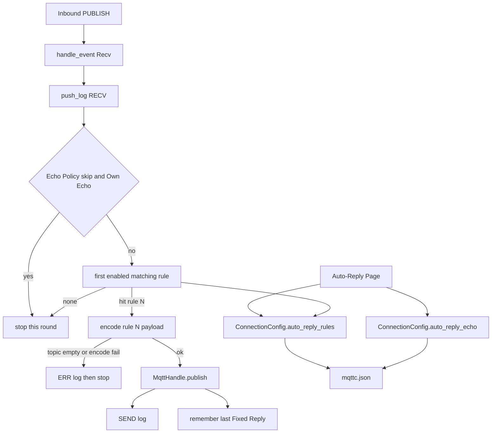

# 自动回复

Feature Name: auto-reply
Updated: 2026-10-08
Status: implemented in `2d14018`

## Description

每条连接保存一份可增减的自动回复规则，以及连接级自身回投策略。规则在独立页面编辑；每条规则有自己的启用复选框，勾选后才参与匹配。Broker 推来 PUBLISH 后先记 RECV 日志，再按列表顺序评估已勾选规则：匹配 Topic 用现有 MQTT `+` / `#` 过滤器，Payload 包含按 UTF-8 文本区分大小写。第一条命中的规则用自己的固定 Topic / Payload / QoS / Retain / 格式发出；本轮不再看后面的规则。手动发布、发布预设、定时发布保持原路径。

## Architecture

页面编号：`0` 连接配置、`1` 会话、`2` 设置、`3` 自动回复。左侧栏在「设置」上方增加「自动回复」，切页前 `sync_form`（含规则列表与 Echo Policy）。



评估在 UI 线程、`handle_event` 写完 RECV 之后进行，与 rumqttc 工作线程解耦。规则字段来自当前连接的 `ConnectionConfig`，不读底部发布表单、不读发布预设。

可见 Auto-Reply Page 时若收到消息，先把界面上的规则同步进配置再评估，避免未点离开时用到旧列表。

## Components and Interfaces

- `AutoReplyRule`（`src/config.rs`）：单条规则，自包含启用勾选、匹配与回复字段
- `ConnectionConfig.auto_reply_rules`：`Vec<AutoReplyRule>`，允许空；旧配置缺字段时反序列化为空列表
- `ConnectionConfig.auto_reply_echo`：`"skip"`（默认）或 `"rematch"`
- `ConnRuntime.last_auto_reply`：最近一次 Fixed Reply 的 `(topic, payload_bytes)`，供 Own Echo 判断；断开或删除连接时清空
- `ui/app-window.slint`：`page == 3` 的 Auto-Reply Page；`AutoReplyRuleRow`（行首 `CheckBox` 绑定 `enabled`）；`auto-reply-requested` / `add-auto-reply-requested` / `delete-auto-reply-requested(int)`
- `show_page(..., 3)`：左侧「自动回复」进入；返回会话仍走现有 `back-to-session-requested`
- `maybe_auto_reply`（`src/main.rs`）：RECV 之后的第一命中发送；编码与日志复用 `encode_payload` / `push_log_for` / `MqttHandle.publish`
- `topic_matches_filter`：匹配 Topic 与日志订阅筛选共用
- `refresh_auto_reply` / `sync_auto_reply`：与 `refresh_publish_presets` / `sync_publish_presets` 同一模式，挂在 `refresh_active_form` 与 `sync_form`

## Data Models

```text
AutoReplyRule
  enabled: bool              // per-rule checkbox; default false (unchecked)
  match_topic: String        // MQTT filter; empty skips the rule
  payload_contains: String   // empty = any payload; else case-sensitive UTF-8 contains
  reply_topic: String
  reply_payload: String
  qos: u8                    // 0..=2
  retain: bool
  format: String             // text | json | base64 | hex

ConnectionConfig
  auto_reply_rules: Vec<AutoReplyRule>
  auto_reply_echo: String    // skip | rematch

ConnRuntime
  last_auto_reply: Option<(topic: String, payload: Vec<u8>)>
```

Echo Policy 存字符串以便 `mqttc.json` 可读。未知值按 `"skip"`。

Own Echo：入站 Topic 与 Payload 字节均等于 `last_auto_reply`。比较原始字节，不按显示格式解码。仅自动回复发出的报文写入该槽；手动发布、预设、定时发布不更新该槽。

规则条数不设硬上限。软件渲染下列表过长会抬高内存，实现时列表用 `ListView` 虚拟化行高。

## Correctness Properties

- 规则 N 匹配成功时只发送规则 N 自己的回复字段
- 规则 N 的启用复选框只控制规则 N；取消勾选后该条被跳过，其余规则的勾选状态不变
- 同一条 Inbound Publish 最多触发一次 Fixed Reply（第一条命中的已勾选规则）
- Fixed Reply 成功后底部 `pub_*` 与 3 个发布预设与发送前一致
- 定时发布与预设发送不读取 `auto_reply_rules`
- 旧 `mqttc.json` 缺自动回复字段时仍能加载，规则为空，Echo Policy 为 skip
- Echo Policy 为 skip 时，Own Echo 记 RECV 且本轮不评估规则
- Echo Policy 为 rematch 时，Own Echo 与其它入站一样评估规则

## Error Handling

| 条件 | 处理 |
| --- | --- |
| 未连接 | 不评估、不发送；页面仍可编辑 |
| 规则关闭或匹配 Topic 为空 | 跳过该条，继续下一条 |
| 匹配成功但回复 Topic 为空 | ERR 日志提示回复 Topic 为空，结束本轮 |
| JSON / Base64 / Hex 编码失败 | ERR 日志写编码错误，结束本轮 |
| MQTT publish 失败 | ERR 日志写错误，结束本轮，不更新 `last_auto_reply` |
| Payload 非合法 UTF-8 且规则填了 Payload 包含 | 用有损 UTF-8 文本做 contains；匹配失败则继续下一条 |
| 删除规则时下标越界 | 忽略该次删除 |

匹配成功但发送失败仍结束本轮：该条已命中，后面的规则本轮不再使用。

## Test Strategy

- `AutoReplyRule` 与 `ConnectionConfig` 往返保留多条规则的全部字段与 Echo Policy
- 缺 `auto_reply_rules` / `auto_reply_echo` 的 JSON 加载为空列表与 skip
- 第一条已勾选规则命中后，第二条即使也匹配也不发送（纯函数测匹配选择）
- 未勾选规则、空匹配 Topic 被跳过；Payload 包含区分大小写（`Hello` 不匹配 `hello`）
- 勾选规则 N 不改变规则 M 的 `enabled`
- 空 `payload_contains` 在 Topic 命中时视为匹配
- Own Echo：相同 Topic 与相同字节在 skip 下跳过评估，在 rematch 下进入评估
- 手动发布不写入 `last_auto_reply`

匹配选择做成 `src/main.rs` 内可单测的纯函数，例如 `select_auto_reply_rule(rules, topic, payload_text) -> Option<usize>`，避免为 UI 启窗口。

## References

[^1]: (Filename) - 当前工作区 `/src/main.rs`
[^2]: (Filename) - 当前工作区 `/src/config.rs`
[^3]: (Filename) - 当前工作区 `/ui/app-window.slint`
[^4]: (Filename) - 当前工作区 `/.monkeycode/specs/auto-reply/requirements.md`
