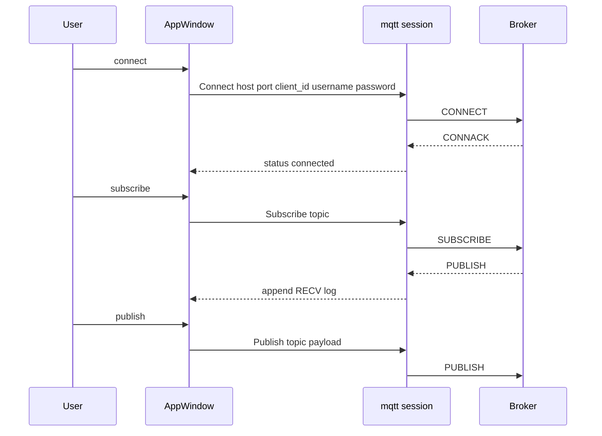

# mqttc Windows MVP

Feature Name: mqtt-debug-client
Updated: 2026-10-08

## Description

原始 Windows MVP 设计，保留作历史基线。当时交付一个 Slint 窗口 + rumqttc MQTT 3.1.1 会话，覆盖连接、订阅、发布与消息日志。当前实现已扩展到 MQTT 5.0、TLS、多连接并行、发布预设、自动回复、皮肤与中英界面；详见后续规格与 wiki。

## Architecture



主线程创建 `AppWindow` 并绑定回调。`src/mqtt.rs` 持有 `Arc<Mutex<Session>>`：`Session` 内存放 `rumqttc::Client` 与事件线程句柄。`Connection::iter()` 在后台线程阻塞轮询，任何 UI 更新经 `slint::invoke_from_event_loop` 回到主线程。

## Components and Interfaces

### AppWindow

声明式界面，职责仅限展示与收集输入。连接中禁用连接按钮；未连接禁用订阅、发布、断开。

### Session

- `connect`: 若已有会话先断开，再 `MqttOptions::new` + `Client::new`；用户名非空时调用 `set_credentials`，然后 `spawn` 轮询线程
- `subscribe` / `publish`: 对当前 `Client` 调用对应方法
- `disconnect`: `Client::disconnect()`，轮询线程在 `iter()` 出错或结束后退出
- 使用单调 `generation`，避免旧线程在重连后写 UI

### Log pipeline

会话事件映射为 `LogEntry`，由主线程写入 `VecModel`。种类：`SYS`、`RECV`、`SEND`、`ERR`。

## Data Models

```text
Session {
  generation: u64
  client: Option<Client>
}

LogEntry {
  time: string
  kind: string
  topic: string
  payload: string
}

MqttOptions {
  client_id: string
  host: string
  port: u16
  keep_alive: 30s
  clean_session: true
  connection_timeout: 10s
  credentials: optional username and password
}

AppConfig {
  host, port, client_id, username, password
  sub_topic, pub_topic, pub_payload
}
```

## Correctness Properties

- 同一时刻最多一个活动 `Connection` 轮询线程
- 仅 ConnAck 成功后 `connected == true`
- 配置文件路径为可执行文件同目录的 `mqttc.json`
- 未连接时订阅与发布只写日志，不调用 `Client`
- 后台线程不直接触碰 Slint 组件句柄，只提交到事件循环
- 日志上限 500 条

## Error Handling

| 场景 | 处理 |
|------|------|
| 端口无法解析 | ERR 日志，保持未连接 |
| 主机为空 | ERR 日志，保持未连接 |
| TCP/协议错误 | 置未连接，ERR 日志，丢弃 Client |
| subscribe/publish 在 Client 已失效时 | ERR 日志 |
| Payload 非合法 UTF-8 | 使用有损转换显示 |

## Test Strategy

- 手工：连接 `test.mosquitto.org:1883`，订阅 `mqttc/mvp/#`，向 `mqttc/mvp/hello` 发布，日志出现 SEND 与 RECV
- 手工：错误端口应出现 ERR 且无法订阅
- 编译：`cargo build` 在开发环境通过，作为 Windows 同源代码的基线

## References

[^1]: (Website) - [Slint Rust 文档](https://docs.slint.dev/latest/docs/rust/slint/)
[^2]: (Website) - [rumqttc README](https://github.com/bytebeamio/rumqtt/blob/main/rumqttc/README.md)
