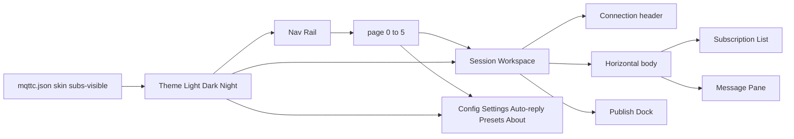
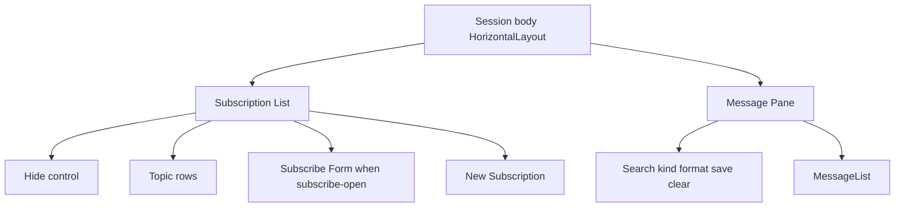

# MQTTX 式全窗口壳层

Feature Name: mqttx-shell
Updated: 2026-11-01

## Description

把 mqttc 全窗口改成 MQTTX Desktop 的聊天式骨架：最左 Nav Rail 管连接与次级入口；会话工作区是顶栏、左侧可隐藏的订阅列表、中间聊天气泡、底部发布区。皮肤改为跟随系统 / Light / Dark / Night，色板按 MQTTX 三套主题映射。协议、多连接、TLS、定时发布、发布预设、自动回复、字号与密度保持现有实现。

## Architecture



窗口仍是单文件 `ui/app-window.slint` + `src/main.rs` 回调。`page` 编号不变：0 连接配置、1 会话、2 设置、3 自动回复、4 发布预设、5 关于。

会话工作区从「顶栏 / 消息（含花签）/ 发布」改为：

1. 顶栏：名称、地址摘要、状态、编辑 / 连接 / 断开
2. 中段横向：左侧 Subscription List + 右侧 Message Pane
3. 底部 Publish Dock：发布字段、payload、预设行

订阅表单从消息工具栏横条改为 Subscription List 底部的按需展开区。花签行删除。列表显示/隐藏写入 `mqttc.json` 的 `subs_visible`。

## Components and Interfaces

### Theme

`Theme.skin` 视觉索引改为三档：

| 视觉索引 | 主题 | 窗口底 | 面板 | 强调色 |
|----------|------|--------|------|--------|
| 0 | Dark | `#212223` | `#262729` | `#34c388` |
| 1 | Light | `#f9fafd` | `#ffffff` | `#34c388` |
| 2 | Night | `#212328` | `#292b33` | `#34c388` |

`Theme.pick(dark, light, night)` 按 `skin` 取值。Light 的 Nav Rail 与工作区同属浅色系：栏底 `#ffffff`、条目 `#f1f8fc`、文字 `#222b3b`。Dark / Night 的 Nav Rail 与窗口同属深色系，Night 条目偏蓝灰 `#31333f`。新安装无 `mqttc.json` 时皮肤为跟随系统。

收发气泡：RECV 用浅绿底、靠左；SEND 用主题强调底、靠右。SYS / ERR 通栏，配色跟现有 `sys-*` / `err-*` Token。

字号与密度 Token 保持 ui-scale：`font-px` 11/12/14/16，`dens-pct` 75/90/110。`sub-panel-w` 继续作为 Subscription List 首选宽度。新增 `nav-w` 作为 Nav Rail 宽度 Token，下限约 160px。

### Nav Rail

连接列表上、四个次级入口下。条目保留状态色点与删除 `×`。次级入口改为等高文字按钮，当前 `page` 对应项用 `nav-selected` 高亮。三套主题下 Nav Rail 都跟窗口同色系。

### Session Workspace

顶栏结构保持，外层裁剪框 + `Flickable`（只写 `width: 100%`，`min-width` 放在外层 Rectangle）。

中段：



- `subs-visible == true`：左侧列表 `preferred-width: Theme.sub-panel-w`，`min-width: 0px`
- `subs-visible == false`：不创建列表节点，Message Pane 占满中段
- 列表顶部右侧提供隐藏控件；列表隐藏时顶栏「断开」后出现「订阅列表」以重新显示
- 每行 Topic + QoS，点击筛选，`×` 取消订阅，选中行 `Theme.sub-selected`
- 列表底部「新建订阅」把 `subscribe-open` 置 true；成功后 Rust 置 false，与现逻辑相同
- 空列表仍渲染容器与新建入口

Publish Dock 保持现字段与预设横滑行。预设行、发布栏继续用外层 clip + 内层 `Flickable`。

### Secondary Page

连接配置、设置、自动回复、发布预设、关于：右侧仍是圆角面板，padding / spacing 全部走 Theme Token。设置页皮肤下拉改为四项：跟随系统、Light、Dark、Night。

### Rust

`Skin` 枚举改为 `System | Light | Dark | Night`。

| 设置页索引 | 键 | 视觉索引 |
|------------|-----|----------|
| 0 System | `system` / `auto` / `follow` | OS 深色→0 Dark，浅色→1 Light |
| 1 Light | `light` / `white` | 1 |
| 2 Dark | `dark` / `black` | 0 |
| 3 Night | `night` / `blue` / `green` / `purple` | 2 |

未知键按 Dark。`default_skin()` 从 `black` 改为 `system`。`is_light()` 只对解析后的 Light 为真。`window_bg_rgb` / `caption_text_rgb` 跟三套主题走，供 Windows 标题栏。

新增窗口属性 `subs-visible`，与 `AppConfig.subs_visible`（默认 true）同步。切换隐藏时 `sync_prefs` + `persist`。`subscribe-open` 仍不入库。

回调保持现名。`unsubscribe-requested` / `filter-subscription-requested` 的触发控件从花签改为列表行。

## Data Models

`mqttc.json` 根级增加：

```json
{
  "skin": "dark",
  "subs_visible": true
}
```

| 字段 | 取值 | 缺省 / 未知 |
|------|------|-------------|
| skin | system, light, dark, night | system；white→light，black→dark，blue/green/purple→night |
| subs_visible | true, false | true |

连接级字段、发布预设、自动回复、字号、密度不变。密码仍不入库。

## Correctness Properties

- `page` 0 到 5 的入口与返回路径与现实现相同
- 隐藏订阅列表后 Message Pane 使用中段全部宽度；再次显示后列表回到消息区左侧
- 切换连接刷新订阅行，不改变 `subs-visible`
- 订阅成功收起表单；失败保持打开并写 ERR
- 旧 `mqttc.json` 缺 `subs_visible` 时列表可见；旧五色皮肤键能加载为 Light / Dark / Night
- `Field` 仍覆盖 Fluent 160×32 下限；`Flickable` 不同时写 `width` 与 `min-width`
- 三套主题下连接 / 发送主按钮可读，强调色为 `#34c388`

## Error Handling

- 未连接时新建订阅入口与发布按钮不可用
- Topic 为空或 Broker 拒绝：表单保持打开，日志写 ERR
- 取消订阅失败：日志写 ERR，列表按配置刷新
- 皮肤键无法识别：按 Dark 渲染，不中断启动

## Test Strategy

- 扩展 `skin_index_and_key_round_trip`：System / Light / Dark / Night 索引与键往返；`white`→Light，`black`→Dark，`blue`/`green`/`purple`→Night
- 新增 `subs_visible` 缺省为 true、读写往返
- `cargo test --offline` 现有 36 项继续通过
- 手工：三套主题切左栏与气泡；隐藏/显示订阅列表；窄窗口顶栏与发布栏右侧完整；Light 下 Nav Rail 与工作区同为浅色

## References

[^1]: (Website) - [MQTTX Desktop Get Started](https://mqttx.app/docs/get-started)
[^2]: (Website) - [MQTTX 消息的发布与订阅](https://github.com/emqx/MQTTX/blob/main/docs/desktop/zh/use-desktop/pub-sub.md)
[^3]: (Filename) - [MQTTX Dark 色板](https://github.com/emqx/MQTTX/blob/main/src/assets/scss/theme/dark.scss)
[^4]: (Filename) - [MQTTX Light 色板](https://github.com/emqx/MQTTX/blob/main/src/assets/scss/theme/light.scss)
[^5]: (Filename) - [MQTTX Night 色板](https://github.com/emqx/MQTTX/blob/main/src/assets/scss/theme/night.scss)
[^6]: (Filename) - [当前窗口壳层](ui/app-window.slint)
[^7]: (Filename) - [皮肤与偏好](src/main.rs)
[^8]: (Filename) - [mqttx-shell 需求](.monkeycode/specs/mqttx-shell/requirements.md)
