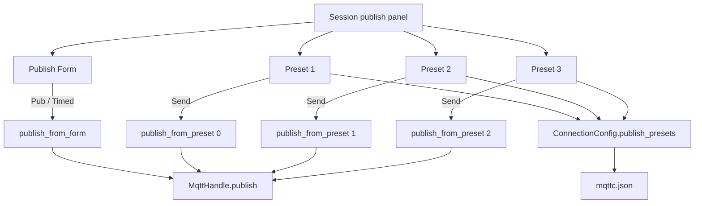

# 发布预设

Feature Name: publish-presets
Updated: 2026-10-03

## Description

每个连接固定保存 3 个发布预设。会话页发布栏下方展示这 3 条；点某条的发送按钮即用该预设的 Topic、Payload、QoS、Retain 与格式发布。底部发布表单与定时发布继续使用原字段，预设发送不覆盖表单。

## Architecture



UI 主线程在 `sync_form` 时把 3 条预设写回当前连接；`refresh_active_form` 反向填入。发送路径与现有发布共用编码、日志和连接检查，只是字段来源改为指定下标的预设。

## Components and Interfaces

- `PublishPreset`（`src/config.rs`）：名称、Topic、Payload、QoS、Retain、格式字符串
- `ConnectionConfig.publish_presets`：长度固定为 3；加载旧配置时补空或截断
- `ui/app-window.slint`：`PublishPresetRow` 组件，会话页发布栏下方 3 行
- `preset-publish-requested(int)`：下标 0..2，发送对应预设
- `publish_from_preset`（`src/main.rs`）：按预设字段发布，不改 `pub-topic` / `pub-payload`

## Data Models

```text
PublishPreset
  name: String
  topic: String
  payload: String
  qos: u8
  retain: bool
  format: String   // text | json | base64 | hex
```

空名称时界面占位为「预设 1 / 2 / 3」。空 Topic 的预设可以编辑，发送时拒绝。

## Correctness Properties

- 每条连接始终恰好 3 个预设
- 预设发送成功后底部表单字段与发送前一致
- 定时发布只读取底部表单对应的 `pub_*` 字段
- 旧 `mqttc.json` 缺 `publish_presets` 时仍能加载

## Error Handling

| 条件 | 处理 |
| --- | --- |
| 未连接时点发送 | 拒绝，日志提示先连接 |
| Topic 为空 | 拒绝，日志提示 Topic 为空 |
| JSON / Base64 / Hex 编码失败 | 拒绝，日志写编码错误 |
| MQTT publish 失败 | 日志写错误，表单与预设保持原值 |

## Test Strategy

- 配置往返保留 3 个预设的名称、Topic、QoS、Retain、格式
- `ensure_publish_presets` 把 0 条补到 3 条、把超过 3 条截到 3 条
- 加载缺字段的连接配置后 `publish_presets.len() == 3`

## References

[^1]: (Filename) - 当前工作区 `/src/config.rs`
[^2]: (Filename) - 当前工作区 `/ui/app-window.slint`
[^3]: (Filename) - 当前工作区 `/.monkeycode/specs/publish-presets/requirements.md`
