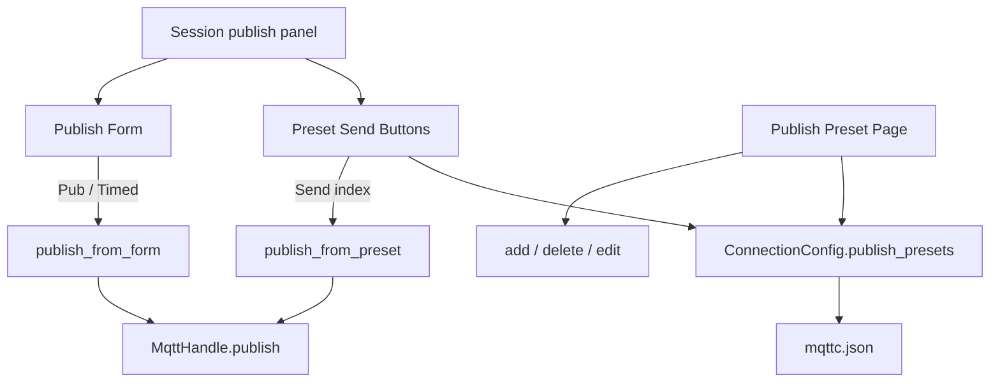

# 发布预设

Feature Name: publish-presets
Updated: 2026-10-08

## Description

每条连接保存一份可增减的发布预设。规则在独立页面编辑；会话页底部发布表单下方只放发送按钮。点某条的发送按钮即用该预设的 Topic、Payload、QoS、Retain 与格式发布。底部发布表单与定时发布继续使用原字段，预设发送不覆盖表单。

## Architecture

页面编号：`0` 连接配置、`1` 会话、`2` 设置、`3` 自动回复、`4` 发布预设。左侧栏在「自动回复」下方、「设置」上方增加「发布预设」，切页前 `sync_form`。



UI 主线程在 `sync_form` 时把预设列表写回当前连接；`refresh_active_form` 反向填入。发送路径与现有发布共用编码、日志和连接检查，字段来源为指定下标的预设。会话页发送区只读名称并触发 `preset-publish-requested(int)`。

## Components and Interfaces

- `PublishPreset`（`src/config.rs`）：名称、Topic、Payload、QoS、Retain、格式字符串
- `ConnectionConfig.publish_presets`：`Vec<PublishPreset>`，允许空；旧配置缺字段时反序列化为空列表
- `ensure_publish_presets`：只规范化格式与 QoS，不补齐、不截断条数
- `ui/app-window.slint`：`page == 4` 的 Publish Preset Page；会话页发布表单下方按列表展示发送按钮，固定一行，超出时横向滑动
- `publish-presets-requested` / `add-publish-preset-requested` / `delete-publish-preset-requested(int)`
- `preset-publish-requested(int)`：发送对应下标预设
- `publish_from_preset`（`src/main.rs`）：按预设字段发布，不改 `pub-topic` / `pub-payload`
- `refresh_publish_presets` / `sync_publish_presets`：与自动回复同一模式，挂在 `refresh_active_form` 与 `sync_form`

## Data Models

```text
PublishPreset
  name: String
  topic: String
  payload: String
  qos: u8
  retain: bool
  format: String   // text | json | base64 | hex

ConnectionConfig
  publish_presets: Vec<PublishPreset>
```

空名称时会话页发送按钮标签为「预设」加从 1 起的序号。空 Topic 的预设可以编辑，发送时拒绝。条数不设硬上限；软件渲染下列表过长会抬高内存，配置页用 `ListView` 虚拟化行高。

## Correctness Properties

- 预设 N 发送时只使用预设 N 自己的字段
- 预设发送成功后底部表单字段与发送前一致
- 定时发布只读取底部表单对应的 `pub_*` 字段
- 旧 `mqttc.json` 缺 `publish_presets` 时仍能加载，列表为空
- 已有文件中的预设条数保持原样，加载后不截成 3 条、不补到 3 条

## Error Handling

| 条件 | 处理 |
| --- | --- |
| 未连接时点发送 | 拒绝，日志提示先连接 |
| Topic 为空 | 拒绝，日志提示 Topic 为空 |
| JSON / Base64 / Hex 编码失败 | 拒绝，日志写编码错误 |
| MQTT publish 失败 | 日志写错误，表单与预设保持原值 |
| 删除预设时下标越界 | 忽略该次删除 |

## Test Strategy

- 配置往返保留多条预设的名称、Topic、QoS、Retain、格式
- `ensure_publish_presets` 规范化 QoS 与格式，保持原条数
- 加载缺字段的连接配置后 `publish_presets` 为空列表
- 新增默认预设字段为空、QoS 0、格式文本

## References

[^1]: (Filename) - 当前工作区 `/src/config.rs`
[^2]: (Filename) - 当前工作区 `/src/main.rs`
[^3]: (Filename) - 当前工作区 `/ui/app-window.slint`
[^4]: (Filename) - 当前工作区 `/.monkeycode/specs/publish-presets/requirements.md`
