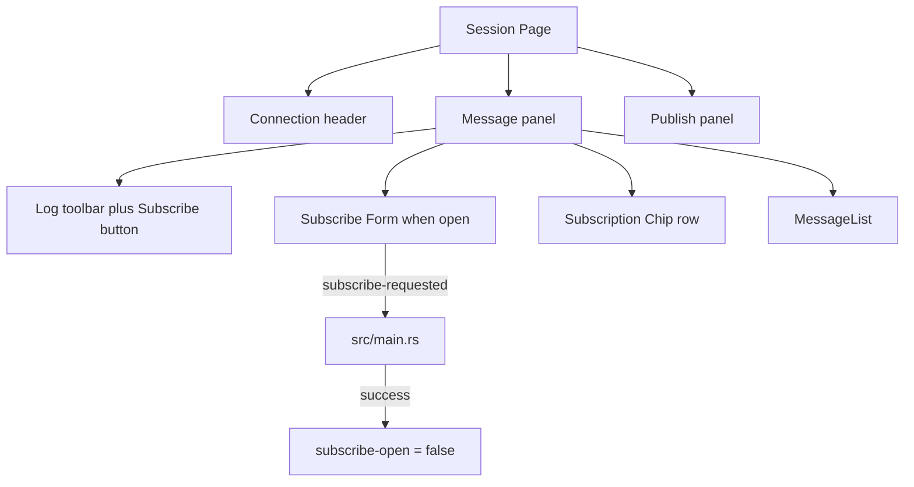

# 会话页表单对齐与折叠订阅

Feature Name: session-layout
Updated: 2026-10-29

## Description

用 `Field` 覆盖 Fluent `LineEdit` 的 160×32 下限，高度绑 `Theme.control-h`，文字左对齐。会话页去掉常驻左侧订阅栏；点「订阅」展开表单，成功或取消后收起。已订阅 Topic 以花签放在消息工具栏下方。

## Architecture

会话页从「左订阅栏 + 右消息/发布」改为上下三块：顶栏、消息（含折叠订阅）、发布。订阅状态只活在窗口属性 `subscribe-open`，不写入 `mqttc.json`。

## Components and Interfaces

### Field

`component Field inherits LineEdit`：

- `min-width: 0px`
- `height` / `min-height`: `Theme.control-h`
- `font-size`: `Theme.font-md`
- `horizontal-alignment: left`
- `vertical-stretch: 0`

各页单行输入从 `LineEdit` 换成 `Field`。`TextEdit` 仍用于多行 Payload。

### FieldLabel

增加 `vertical-alignment: center`，与同一行的 `Field` / `Select` / `Button` 对齐。

### AppWindow

- `in-out property <bool> subscribe-open: false`
- 会话页消息工具栏增加「订阅」按钮，已连接时可把 `subscribe-open` 置为 true
- `if root.subscribe-open` 显示 Topic `Field`、QoS `Select`、确认订阅、取消
- 取消把 `subscribe-open` 置 false
- `subscriptions` 非空时在消息列表上方画 Chip 行

### Rust

- 订阅成功（含已在列表中）后 `ui.set_subscribe_open(false)`
- 订阅失败保持打开
- `refresh_active_form` 切换连接时 `set_subscribe_open(false)`

## Data Models

无新增持久化字段。`sub-topic` / `sub-qos` / `subscriptions` 仍按现有连接配置读写。

## Correctness Properties

- 未打开订阅表单时，消息区使用会话页全部剩余宽度
- 表单收起后已订阅 Chip 仍可筛选与取消
- `Field` 在窄列（端口、间隔秒）可收到列宽以内
- 切换连接不会留下上一条连接的展开表单

## Error Handling

- 未连接点订阅入口：按钮不可用
- Topic 为空或 Broker 拒绝：表单保持打开，日志写 ERR
- 取消订阅失败：日志写 ERR，Chip 仍按配置列表刷新

## Test Strategy

- `cargo test --offline` 覆盖现有订阅与配置往返
- 手工：连接后展开订阅、订一条后表单消失、Chip 可筛选与取消
- 手工：端口、Keep Alive、定时秒数字段与按钮同高，文字靠左

## References

- `ui/app-window.slint` Session Page 与 `Field`
- `src/main.rs` `on_subscribe_requested` / `refresh_active_form`
- Fluent LineEdit 默认 `min-width: max(160px, …)`、`min-height: max(32px, …)`
