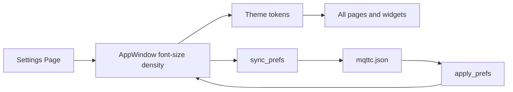

# 设置页字号与界面密度

Feature Name: ui-scale
Updated: 2026-10-27

## Description

在设置页增加字号（小 / 中 / 大 / 特大）与界面密度（紧凑 / 标准 / 宽松）。`Theme` 根据两档算出字号与长度 Token，各页用 Token 替换写死的 `font-size`、padding、spacing 与关键宽度/高度。选择立即生效，根级写入 `mqttc.json`，读写路径与皮肤、语言相同。

## Architecture



启动时 `apply_prefs` 把配置键写成 `Theme` 索引。用户改下拉时 `changed` 触发 `ui-scale-changed`，`sync_prefs` + `persist` 写回。窗口 `default-font-size` 绑定 `Theme.font-base`，标准控件跟基准字号走。

## Components and Interfaces

### Theme

新增：

- `font-size: int`：0 小、1 中、2 大、3 特大，默认 1
- `density: int`：0 紧凑、1 标准、2 宽松，默认 1
- `font-px()`：11 / 12 / 14 / 16
- `dens-pct()`：75 / 90 / 110
- `sz(base)`：`base * font-px * dens-pct / 1400` 像素，用于间距与控件尺寸

字号 Token 只跟 `font-px` 走（不含密度）：`font-xs` = px−3，`font-sm` = px−2，`font-md` = px−1，`font-base` = px，`font-lg` = px+1，`font-title` = px+2，`font-hero` = px+8。

长度 Token 走 `sz`：`space-1`…`space-8` 对应 2/4/6/8/10/12/16/18；`control-h`、`menu-item-h`、`row-conn`、`row-sub`、`payload-h`、`sidebar-w`、`sub-panel-w`、`window-min-w` / `window-min-h`。宽度与高度设下限，避免紧凑+小字时点不到。

### AppWindow

- `font-size <=> Theme.font-size`
- `density <=> Theme.density`
- `callback ui-scale-changed()`
- `default-font-size: Theme.font-base`
- `min-width` / `min-height` 绑 `Theme.window-min-w` / `Theme.window-min-h`

设置页在语言块下方增加两组 `Select`，说明文案走 `I18n.t`。

### Rust

`FontSize`、`UiDensity` 与 `Skin` / `Lang` 相同：`from_index` / `from_key` / `to_index` / `to_key`。未知键分别落到 `Medium`、`Standard`。

`AppConfig` 增加 `font_size`、`ui_density`，`serde(default)`。`apply_prefs` / `sync_prefs` 读写这两项。`on_ui_scale_changed` 里 `sync_prefs` + `persist`。

## Data Models

`mqttc.json` 根级：

```json
{
  "font_size": "medium",
  "ui_density": "standard"
}
```

| 字段 | 取值 | 缺省 / 未知 |
|------|------|-------------|
| font_size | small, medium, large, xlarge | medium |
| ui_density | compact, standard, comfortable | standard |

加载时额外接受 `12` / `14` / `16` / `18` 与 `sm` / `md` / `lg` / `xl` 作为字号别名。

## Correctness Properties

- 旧文件缺字段仍能加载，字号中、密度标准
- 未知键不导致解析失败
- 字号索引与键往返一致；密度索引与键往返一致
- 同一组 Token 覆盖全部 `page`，不按页单独存一份
- 密码与连接字段行为不变

## Error Handling

配置缺字段或未知值时静默落到缺省，不弹窗、不写 ERR。界面下拉只提供合法四档 / 三档，不出现越界索引。

## Test Strategy

- `FontSize` / `UiDensity` 索引与键往返，未知值落到缺省
- `AppConfig` 序列化包含新字段；缺字段的 JSON 反序列化为 medium / standard
- 现有配置往返测试补上新字段断言
- `cargo test` 全量；手动：改字号与密度后看会话页、缩窗口、重启仍保持选择

## References

[^1]: (Filename) - [设置页与 Theme](../../../ui/app-window.slint)
[^2]: (Filename) - [AppConfig 偏好](../../../src/config.rs)
[^3]: (Filename) - [apply_prefs / sync_prefs](../../../src/main.rs)
[^4]: (Filename) - [接口定义](../../docs/INTERFACES.md)
