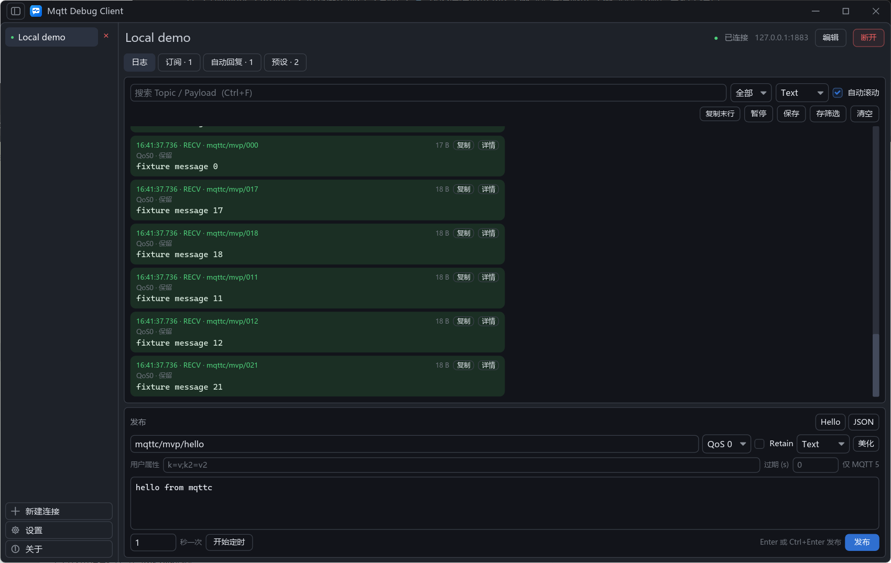

# mqttc

[简体中文](README.md) | English

A lightweight, cross-platform MQTT debugging client for Windows, Linux and macOS.



## Download

Get the latest build from [Releases](https://github.com/GordonWen/mqttc/releases/latest):

| Platform | File | Notes |
|---|---|---|
| Windows 10/11 x64 | `mqttc-v1.1.0-windows-x64.zip` | Unzip and run `mqttc.exe` |
| Linux x64 | `mqttc-v1.1.0-linux-x64.tar.gz` | Requires glibc 2.35+, libxkbcommon, Wayland or X11 |
| macOS 11+ | `mqttc-v1.1.0-macos-universal.zip` | Universal (Apple Silicon + Intel); unsigned |

`mqttc.json` and exported `logs/` live next to the executable. Nothing is written to the
registry or the user profile, so the whole folder can travel on a USB stick.

The macOS build is unsigned. On first launch, right-click `mqttc.app` → Open, or run:

```bash
xattr -dr com.apple.quarantine mqttc.app
```

## Why it stays lightweight

The release build uses iced with tiny-skia software rendering: no GPU dependency, and no
bundled CJK fonts. Measured on Windows x64 release builds (median of 3 independent
processes; see the [benchmark report](docs/BENCHMARK.en.md)):

| Scenario | Working set | Comparison |
|---|---|---|
| Startup, idle | 28.8 MB | 32.2 MB for the author's earlier Slint build |
| Connected + 200 log entries | 30.8 MB | Slint 38.4 MB / egui 107.9 MB |
| Streaming receive at 10 msg/s | 30.8 MB | — |
| Timed publish at 1 Hz | 31.2 MB | — |

- 5.98 MB exe, 2.83 MB portable zip
- Idle CPU near 0%; at most 0.03% while receiving 10 msg/s (normalized to 16 logical cores)
- 200 log lines per connection by default, adjustable up to 2000 in settings; each
  connection also has a separate 16 MB byte budget

## Features

- Multi-connection management: add / edit / delete / switch, with an independent session
  per connection
- MQTT 3.1.1 and 5.0; QoS 0/1/2, Clean Session, Keep Alive, connect timeout, Last Will
- TLS: system roots, custom CA (trust that CA only), client certificate / private key,
  skip certificate verification
- Session tabs: Logs / Subscriptions / Auto-reply / Preset replies, all scoped to the
  current connection
- Subscriptions: `+` / `#` wildcards, per-QoS subscribe, QoS shown in the list, click a
  subscription to use it as a log filter
- Publish: convert between Text / JSON / Base64 / Hex, pretty-print JSON, QoS and retain
  flag
- Timed publish: 1–3600 s interval
- Preset sending: send several publish presets with one click; pin frequently used ones,
  and the preset bar collapses automatically when names do not fit
- Auto-reply: match by subscribed topic / keyword / payload content; the first matching
  rule in order replies
- Chat-style logs: sent/received bubbles, system events, error hints; bubble width adapts to
  content; only the newest 80 rows are laid out, with "Show older" and "Jump to latest";
  search, type filters, display-format switch, auto-scroll, freeze while scrolled up,
  export, clear; large payload previews are truncated and can be expanded up to 16 KB
- The session header shows received / sent counts with a one-click reset; the log buffer can
  pause capture and adjust its history limit in settings; export the current filtered
  results or all records, with the connection name and a millisecond timestamp in the
  filename
- Chinese and English UI; 7 skins: follow system / dark / light / blue / green / purple /
  custom (27 adjustable color slots)
- 4 UI text sizes that scale the whole window proportionally; frameless window with a
  custom title bar, resize grips and an always-on-top pushpin

## Building from source

Rust 1.98+ and the platform toolchain are required. Release builds only target iced:

```bash
cargo build --release -p mqttc-iced
# Output: target/release/mqttc-iced (mqttc-iced.exe on Windows)
```

Rename the output to `mqttc` (`mqttc.exe` on Windows), place it next to an optional
`mqttc.json`, and run it.

Windows: build all three UIs and produce the portable zip in one step:

```powershell
powershell -ExecutionPolicy Bypass -File scripts\build-windows.ps1
```

Linux (Ubuntu 22.04+):

```bash
sudo apt install build-essential pkg-config libxkbcommon-dev libxkbcommon-x11-dev \
  libwayland-dev libx11-dev libxcb1-dev libxrandr-dev libxi-dev libxcursor-dev \
  libfontconfig1-dev libfreetype6-dev
cargo build --release -p mqttc-iced
```

macOS (Xcode Command Line Tools):

```bash
cargo build --release -p mqttc-iced
```

## Three UIs in this repository

All three full implementations share the same UI-agnostic `mqttc-core` (configuration,
MQTT, logs, filtering, i18n, runtime), so they can be compared side by side:

| App | UI framework | Rendering | Working set | exe | Status |
|---|---|---|---|---|---|
| `mqttc-iced` | Iced 0.14 | tiny-skia software | 28.8–31.2 MB | 5.98 MB | **Released** |
| `mqttc-egui` | egui / eframe 0.37 | OpenGL | 96–111 MB | 8.22 MB | Development alternative |
| `mqttc-gpui` | GPUI 0.2.2 | Direct3D 11 | 47–49 MB | 9.38 MB | Exploratory; some edit pages are read-only |

GPUI differences are documented in [docs/PARITY.en.md](docs/PARITY.en.md); architecture,
build and test details for all three are in
[docs/ARCHITECTURE.en.md](docs/ARCHITECTURE.en.md); full comparison data is in
[docs/BENCHMARK.en.md](docs/BENCHMARK.en.md).

## Tests

```bash
cargo test -p mqttc-core        # codec, wildcards, filtering, config migration, auto-reply, form clamping
cargo test -p mqttc-iced        # 15 page build smoke tests
cargo test -p mqttc-core --test broker_roundtrip   # end-to-end with embedded rumqttd broker
```

Local integration tests use `tools/test-broker` (embedded rumqttd) and never depend on
public services.

## Release

- Windows builds are produced locally by `scripts/release-windows.ps1` and uploaded;
- Linux x64 and macOS universal builds are produced by
  [`.github/workflows/release.yml`](.github/workflows/release.yml) when a `v*` tag is
  pushed and attached to the same GitHub Release.

Maintainer steps are in [docs/RELEASING.en.md](docs/RELEASING.en.md).

## Layout

```text
core/                mqttc-core: config, MQTT, logs, filtering, i18n, forms and runtime (UI-agnostic)
apps/iced/           Released UI (Iced)
apps/egui/           egui/eframe implementation
apps/gpui/           GPUI implementation
tools/test-broker/   Local test broker with embedded rumqttd
tools/bench/         Benchmark scenarios, sampling scripts and fixtures
scripts/             Build, packaging and release scripts
assets/              Icons and attribution
docs/                BENCHMARK / ARCHITECTURE / PARITY / RELEASING
```

## Configuration

`mqttc.json` is compatible with earlier Slint versions. It stores the connection list
(`connections`), the active connection (`active_id`), appearance (`skin`,
`custom_palette`, `font_scale`, `language`), log preferences (`log_format`,
`auto_scroll`) and more; presets support the `pinned` flag. The file is created on first
run when missing, and legacy single-connection configs are migrated automatically. Writes
are atomic (temporary file + rename), and text edits are debounced by 400 ms.

Passwords are stored as-is in the local JSON file. Note that this file is plain text and
is copied along with the folder.

## License

MIT. Icon asset sources are listed in [assets/NOTICE.md](assets/NOTICE.md).
