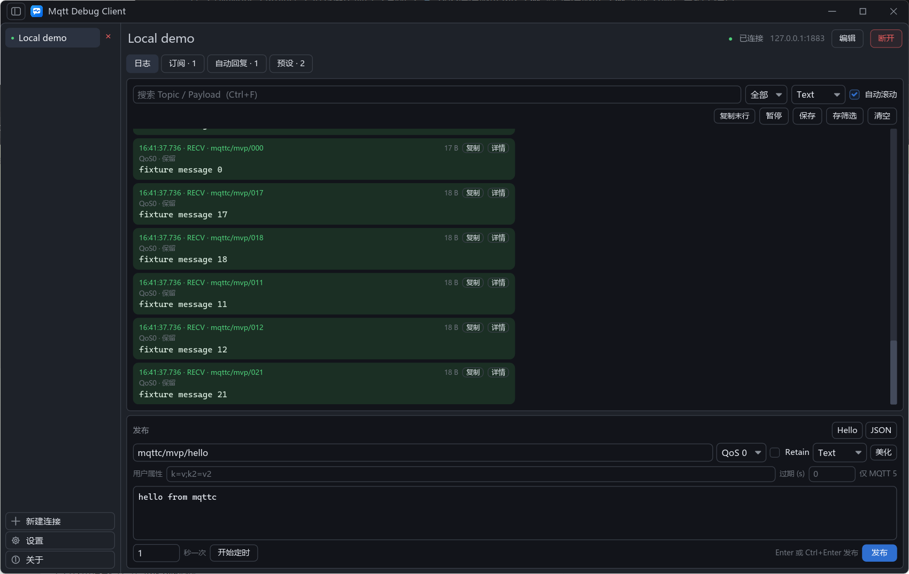

# mqttc

简体中文 | [English](README.en.md)

轻量级跨平台 MQTT 调试客户端，支持 Windows、Linux 和 macOS。



## 下载

前往 [Releases](https://github.com/GordonWen/mqttc/releases/latest)：

| 平台 | 文件 | 说明 |
|---|---|---|
| Windows 10/11 x64 | `mqttc-v1.0.0-windows-x64.zip` | 解压运行 `mqttc.exe` |
| Linux x64 | `mqttc-v1.0.0-linux-x64.tar.gz` | 需要 glibc 2.35+、libxkbcommon、Wayland 或 X11 |
| macOS 11+ | `mqttc-v1.0.0-macos-universal.zip` | Apple Silicon + Intel 通用；未签名 |

配置 `mqttc.json` 与导出的 `logs/` 都在可执行文件同目录，不写注册表、不写用户目录，
整个文件夹可以放在 U 盘里带走。

macOS 构建未签名，首次打开请右键 `mqttc.app` → 打开，或执行：

```bash
xattr -dr com.apple.quarantine mqttc.app
```

## 为什么轻量

Release 使用 iced + tiny-skia 软件渲染，不依赖 GPU，也不打包 CJK 字体。
Windows x64 release 实测（3 次独立进程中位数，详见 [基准报告](docs/BENCHMARK.md)）：

| 场景 | 工作集 | 对比 |
|---|---|---|
| 启动空闲 | 28.8 MB | 同作者早期 Slint 版 32.2 MB |
| 连接 + 200 条日志 | 30.8 MB | Slint 38.4 MB / egui 107.9 MB |
| 10 msg/s 流式接收 | 30.8 MB | — |
| 1 Hz 定时发布 | 31.2 MB | — |

- exe 5.95 MB，portable zip 2.82 MB
- 空闲 CPU 接近 0%；10 msg/s 接收时最高 0.03%（按 16 逻辑核归一）
- 每连接日志默认 200 条，可在设置中调到 2000 条；单连接另设 16 MB 字节预算

## 功能

- 多连接管理：新增 / 编辑 / 删除 / 切换，每条连接独立会话
- MQTT 3.1.1 与 5.0；QoS 0/1/2、Clean Session、Keep Alive、连接超时、Last Will
- TLS：系统根证书、自定义 CA（仅信任该 CA）、客户端证书 / 私钥、跳过证书校验
- 会话页标签：日志 / 订阅 / 自动回复 / 预设，均只作用于当前连接
- 订阅管理：`+` / `#` 通配符，按 QoS 订阅，列表显示 QoS，点击订阅项用作日志过滤
- 发布：文本 / JSON / Base64 / Hex 四种格式互转，JSON 美化，QoS 与保留标志
- 定时发布：1–3600s 间隔
- 预设发送：多条发布预设一键发送，可置顶常用项；预设条按名称宽度自动折叠
- 自动回复：按订阅主题 / 关键字 / 负载内容匹配，按规则顺序首条命中即回复
- 聊天式日志：收发气泡、系统事件、错误提示；搜索、类型筛选、显示格式切换、
  自动滚动、导出、清空；大负载预览自动截断，可展开查看完整内容（上限 16 KB）
- 日志缓冲可暂停接收、可在设置中调整历史上限；导出支持当前筛选结果或全部记录，
  文件名带连接名与毫秒时间戳
- 中英文界面；7 套皮肤：跟随系统 / 黑 / 白 / 蓝 / 绿 / 紫 / 自定义（27 个颜色槽可调）
- 4 档界面字号，整窗文字等比缩放；无边框窗口配自绘标题栏与缩放手柄

## 从源码构建

需要 Rust 1.98+ 与平台工具链。发布版只构建 iced：

```bash
cargo build --release -p mqttc-iced
# 产物：target/release/mqttc-iced（Windows 为 mqttc-iced.exe）
```

把产物重命名为 `mqttc`（Windows 为 `mqttc.exe`），与可选的 `mqttc.json` 放在同一目录即可运行。

Windows 一键构建全部三套 UI 并生成 portable zip：

```powershell
powershell -ExecutionPolicy Bypass -File scripts\build-windows.ps1
```

Linux（Ubuntu 22.04+）：

```bash
sudo apt install build-essential pkg-config libxkbcommon-dev libxkbcommon-x11-dev \
  libwayland-dev libx11-dev libxcb1-dev libxrandr-dev libxi-dev libxcursor-dev \
  libfontconfig1-dev libfreetype6-dev
cargo build --release -p mqttc-iced
```

macOS（Xcode Command Line Tools）：

```bash
cargo build --release -p mqttc-iced
```

## 仓库中的三套 UI

同一份与 UI 无关的核心 `mqttc-core`（配置、MQTT、日志、筛选、i18n、运行时）之上，
保留了三套完整实现，便于横向比较：

| 程序 | UI 框架 | 渲染 | 工作集 | exe | 状态 |
|---|---|---|---|---|---|
| `mqttc-iced` | Iced 0.14 | tiny-skia 软件 | 28.8–31.2 MB | 5.95 MB | **发布版** |
| `mqttc-egui` | egui / eframe 0.37 | OpenGL | 96–111 MB | 8.22 MB | 开发备选 |
| `mqttc-gpui` | GPUI 0.2.2 | Direct3D 11 | 47–49 MB | 9.38 MB | 探索性，少量编辑页只读 |

GPUI 的差异见 [docs/PARITY.md](docs/PARITY.md)；三者的架构、构建与测试说明见
[docs/ARCHITECTURE.md](docs/ARCHITECTURE.md)；完整对比数据见
[docs/BENCHMARK.md](docs/BENCHMARK.md)。

## 测试

```bash
cargo test -p mqttc-core        # 编解码、通配符、筛选、配置迁移、自动回复、表单钳制
cargo test -p mqttc-iced        # 六个页面构建冒烟
cargo test -p mqttc-core --test broker_roundtrip   # 内嵌 rumqttd Broker 端到端
```

本地集成测试使用 `tools/test-broker`（内嵌 rumqttd），不依赖公网服务。

## 发布

- Windows 版由本地 `scripts/release-windows.ps1` 构建并上传；
- Linux x64 与 macOS universal 由 [`.github/workflows/release.yml`](.github/workflows/release.yml)
  在推送 `v*` tag 时构建，并附加到同一个 GitHub Release。

维护者步骤见 [docs/RELEASING.md](docs/RELEASING.md)。

## 目录

```text
core/                mqttc-core：配置、MQTT、日志、筛选、i18n、表单与运行时（UI 无关）
apps/iced/           发布版 UI（Iced）
apps/egui/           egui/eframe 实现
apps/gpui/           GPUI 实现
tools/test-broker/   内嵌 rumqttd 的本地测试 Broker
tools/bench/         基准场景、采样脚本与 fixture
scripts/             构建、打包与发布脚本
assets/              图标与来源说明
docs/                BENCHMARK / ARCHITECTURE / PARITY / RELEASING
```

## 配置

`mqttc.json` 与早期 Slint 版本格式兼容：包含连接列表（`connections`）、当前连接
（`active_id`）、外观（`skin`、`custom_palette`、`font_scale`、`language`）、
日志偏好（`log_format`、`auto_scroll`）等；预设支持 `pinned` 置顶字段。
首次运行若不存在会自动创建；旧版单连接配置会自动迁移。写入采用临时文件 + rename
的原子写，文本编辑做 400ms 防抖。

密码按原样保存在本地 JSON 中，请注意该文件是明文且随目录复制。

## 许可

MIT。图标资产来源见 [assets/NOTICE.md](assets/NOTICE.md)。
