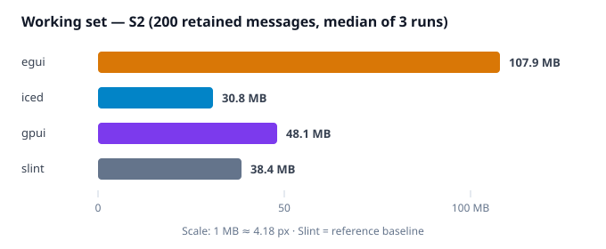
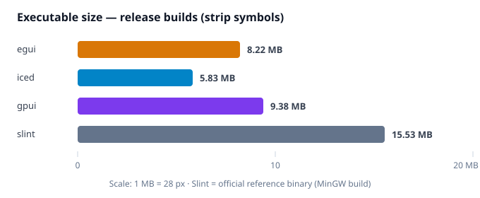

# Benchmark and comparison report

[简体中文](BENCHMARK.md) | English

This report compares memory, CPU, and executable size for four programs on the same
machine, with the same configuration and the same local broker. Among them, iced is this
repository's released build, egui / gpui are in-source comparisons, and the Slint build is
the pre-release performance baseline. Raw CSV files and full details live in the local
`bench/out/` directory (ignored by `.gitignore`) and can be reproduced with
`tools/bench/run-all.ps1`; published Releases do not include benchmark tools or baseline
programs.

## 1. Test environment

| Item | Value |
|---|---|
| OS | Windows 11 Pro Workstation 10.0.22631 (x64) |
| CPU / logical cores | AMD Ryzen 7 8845HS, 8 cores / 16 threads |
| Memory | 31.3 GB |
| GPU | AMD Radeon 780M (integrated) + NVIDIA GeForce RTX 4060 Laptop (plus a virtual display driver) |
| Rust | 1.98.1 MSVC, default `rustc -C target-cpu` |
| Broker | `tools/test-broker` (embedded rumqttd 0.20), `127.0.0.1` |
| Sampling | PowerShell `Get-Process`, 1s interval; CPU normalized by logical core count |

The four programs under test:

| Program | Version / rendering |
|---|---|
| `mqttc-egui` | egui/eframe 0.37, glow (OpenGL) |
| `mqttc-iced` | Iced 0.14, tiny-skia (software raster) |
| `mqttc-gpui` | GPUI 0.2.2, native GPU (Direct3D 11, `release-unwind`) |
| `baseline-slint` | the author's early Slint build v0.1.1, Slint 1.18.1, software rendering (local baseline only, not distributed) |

## 2. Method

### 2.1 Scenarios

- **S1 startup**: no connection. Sample at 2s, 5s, and 30s (3 processes each).
- **S2 connected + 200 log entries**: the broker preloads 200 retained messages (topic
  `mqttc/mvp/#`, QoS 0). After connecting, wait 5s to stabilize, then sample continuously
  for 60s (memory + idle CPU).
- **S3 streaming receive**: the broker pushes at 10 msg/s for 60s.
- **S4 timed publish**: 1 Hz timed publish for 60s.
- Each program, in each scenario, runs **3 independent processes**; the tables use medians
  (memory/CPU) and maxima (peak / working-set upper bound).

### 2.2 Metrics

- `WorkingSet64`: current working set, median and maximum.
- `PrivateMemorySize64`: private committed memory, median.
- `PeakWorkingSet64`: process lifetime peak.
- `TotalProcessorTime` delta / wall clock / logical core count → `CPU%` (expressed as a
  percentage of total machine capacity; this machine has 16 logical cores, so one core
  saturated is about 6.25%).
- `HandleCount` / `ThreadCount`: snapshot at the end of sampling.
- exe size, portable zip size; `dumpbin /dependents` for system dependencies.
- GPU video memory is not part of the working set and is not counted; egui/iced use
  system OpenGL/software raster, while GPUI uses the GPU.

### 2.3 Automation

```powershell
cargo build --release -p mqttc-egui -p mqttc-iced -p mqttc-test-broker
cargo build --profile release-unwind -p mqttc-gpui
powershell -ExecutionPolicy Bypass -File tools\bench\run-all.ps1 -Runs 3 `
    -RetainedPort 1883 -IdlePort 1892 -StreamPort 1893
powershell -ExecutionPolicy Bypass -File tools\bench\baseline.ps1 -Scenario s2 -Runs 3 -Port 1883
powershell -ExecutionPolicy Bypass -File tools\bench\report.ps1 -Out bench\out\tables.md
```

The three new programs are started with
`--bench --bench-scenario sN --bench-quit-after <secs> --config <fixture>`; they connect,
subscribe, publish on a timer, and exit on schedule. The scripts call
`tools/bench/sampler.ps1` after warm-up.

The early Slint build has no command-line arguments: copy the locally retained `mqttc.exe`
to `dist/baseline-slint/`, place the same `mqttc.json` next to the exe (pointing at the
local broker and subscribing to `mqttc/mvp/#`), and `baseline.ps1` uses `SetWindowPos` to
fix the window at 0,0 (1712×1109 physical pixels). It then clicks "Connect" (and "Timed"
for S4) in client coordinates through `tools/bench/uia-click.ps1`, and samples afterwards.
Coordinates are confirmed with `tools/bench/shot.ps1` screenshots; re-confirm after
changing DPI or window size. S1/S2/S3/S4 all use 3 independent processes; S1 takes one
snapshot at 2s / 5s / 30s.

### 2.4 Build profiles

| profile | Settings |
|---|---|
| `release` | opt-level 3, thin LTO, codegen-units 1, strip symbols, panic=abort |
| `release-unwind` | same as `release`, but with unwind enabled (used by GPUI) |
| `release-size` | opt-level "s", fat LTO, otherwise the same as release (extra comparison for egui/iced only) |

`+crt-static` is not enabled; release packages depend on the system VC runtime (usually
present on Windows 10/11).

## 3. Results

> Data is aggregated by `tools/bench/report.ps1` from the local `bench/out/summary.csv`;
> each cell is the median of 3 independent processes. The tables below are reorganized by
> dimension; complete per-scenario details are in the local `bench/out/tables.md` and raw
> CSV files (not distributed with the repository).

### 3.1 Working set (MB)

| Program | S1 2s | S1 5s | S1 30s | S2 200 entries | S3 streaming | S4 timed |
|---|---|---|---|---|---|---|
| egui | 100.4 | 96.9 | 96.3 | 107.9 | 108.2 | 110.6 |
| iced | **28.8** | **28.8** | **28.8** | **30.8** | **30.8** | **31.2** |
| gpui | 47.1 | 47.2 | 47.4 | 48.1 | 48.1 | 49.0 |
| slint (official baseline) | 32.2 | 32.2 | 32.2 | 38.4 | 39.2 | 35.5 |

Relative to the official Slint baseline (S2 38.4 MB): iced is about **0.80×**, gpui about
1.25×, and egui about **2.8×**. iced is below the baseline in every scenario; egui is close
to 100 MB even when idle.



### 3.2 Peak, private memory, CPU, and handles

| Program | Peak WS (largest scenario) | Private memory (largest scenario) | Median idle CPU | Max active CPU | Threads | Handles |
|---|---|---|---|---|---|---|
| egui | 112.9 MB | 112.9 MB | 0.00% | 0.01% | 12–15 | ≈376 |
| iced | 31.4 MB | 17.5 MB | 0.00% | 0.03% | 9–10 | ≈224 |
| gpui | 55.4 MB | 85.9 MB | 0.00% | 0.00% | 26–28 | ≈1,200 |
| slint (official baseline) | 39.9 MB | 22.3 MB | 0.00% | 0.05% | 7–9 | ≈222 |

> GPUI's private committed memory (≈85 MB) is clearly higher than its working set
> (≈48 MB), and it also has the most threads and handles; this is characteristic of the
> Direct3D 11 / DComp runtime. Its working set is still only about 45% of egui's.

### 3.3 Executable and package size

| Build | exe (MB) | portable zip (MB) | Relative to official Slint exe |
|---|---|---|---|
| `mqttc-egui` (release) | 8.22 | 4.01 | 52.9% |
| `mqttc-egui` (release-size) | 6.43 | — | 41.3% |
| `mqttc-iced` (release) | **5.83** | **2.91** | **37.5%** |
| `mqttc-iced` (release-size) | 4.50 | — | 28.9% |
| `mqttc-gpui` (release-unwind) | 9.38 | 3.75 | 60.4% |
| `baseline-slint` (official dist of the early Slint build) | 15.53 | — | 100% |
| local `bench/ref-build` (rebuilt on the same machine and profile) | 14.78 | — | 95.0% |

> The official binary of the early Slint build was produced with the MinGW toolchain
> (depending on `msvcrt.dll`); the local `bench/ref-build` was rebuilt on this machine with
> MSVC and the same `release` profile as this repository, and it is still 14.78 MB. This
> shows that the size baseline of Slint + software rendering is not caused by the
> toolchain. `bench/ref-build` is not in the public repository. Among the three new
> programs, iced is the smallest.



### 3.4 Rendering and threads

| Program | Rendering backend | UI refresh strategy | Per-connection thread |
|---|---|---|---|
| egui | OpenGL (glow) | event wakeup via `request_repaint` | one 256KB-stack MQTT thread |
| iced | tiny-skia software | 100ms tick while active | same as above |
| gpui | GPU (Direct3D 11) | 100ms tick while active / 1s for system skin | same as above |
| slint | software (early Slint build) | built-in timer in the early version | early version |

## 4. Dependency check

```text
dumpbin /dependents target\release\mqttc-egui.exe
```

Summary of `dumpbin /dependents` results (full output in `bench/out/dependents.txt`):

| Program | UI-related system DLLs | C runtime |
|---|---|---|
| egui | `OPENGL32`, `dwrite`, `dwmapi`, `uxtheme`, `imm32`, `combase` | `VCRUNTIME140` + UCRT api-set |
| iced | `dwrite` (no OpenGL), `dwmapi`, `uxtheme`, `imm32` | `VCRUNTIME140` + UCRT api-set |
| gpui | `d3d11`, `dxgi`, `dcomp`, `dwrite`, `comctl32`, `icuuc` | `VCRUNTIME140` + UCRT api-set |
| slint (official) | `dwrite`, `comctl32`, `dwmapi` (software rendering, no GPU DLLs) | `msvcrt.dll` (MinGW build) |

All three depend on the system VC runtime, which Win10 1809+ / Win11 usually ships. TLS
needs `bcrypt`, `crypt32`, and `ws2_32`, all system DLLs; OpenSSL is not bundled.

## 5. Conclusion

Ranked by "memory first, size second, idle CPU third":

1. **iced is the best overall**: working set 28.8–31.2 MB in all scenarios, about 20%
   below the early Slint baseline and about 28% of egui; exe 5.83 MB and portable zip
   2.91 MB, both the smallest. Feature parity with the early Slint build is complete, and
   CJK text uses system font fallback.
2. **gpui is in the middle**: working set 47–49 MB (about 45% of egui), but exe size
   9.38 MB is the largest; private committed memory is about 85 MB, handles about 1,200,
   and threads 26–28, so runtime cost is clearly higher than the other two. It suits cases
   that accept GPU runtime complexity and need GPU animation/text capabilities.
3. **egui has the worst memory**: about 100 MB idle and about 108 MB after connecting with
   200 log entries, roughly 2.8× the baseline. Its strengths are the mature eframe
   ecosystem and developer productivity. If egui is required, accept this memory cost.
4. **Slint baseline (early version)**: memory 32–39 MB and exe 15.53 MB, between iced and
   gpui; its software rendering and compact runtime show that "small memory" does not
   require a GPU.

Idle CPU is close to 0% for all four (≤0.05% after normalization); even active scenarios
(10 msg/s receive or 1 Hz publish) reach only 0.03–0.05%, with no event-polling hotspot
that needs optimization.

**Conclusion**: iced is the official release build (Releases only provide it); egui is the
development-experience/ecosystem alternative; gpui is exploratory, and its feature
differences are documented in `docs/PARITY.en.md`.

## 6. Limitations

- Measured only on Windows 11 x64; macOS / Linux are built by CI and were not measured or
  profiled at runtime.
- GPU video memory (GPUI) and driver residency are not part of `WorkingSet64`; the same
  applies to egui's OpenGL driver memory. Therefore GPUI's "memory advantage" holds only
  under the process working-set metric; its private committed memory is actually higher.
- The official `mqttc.exe` of the early Slint build was a MinGW build; the local
  `bench/ref-build` was rebuilt with this machine's MSVC and the same `release` profile as
  this repository (only the resource compilation changed from windres to the Windows SDK
  `rc.exe`) and is 14.78 MB, close to the official 15.53 MB. Neither that directory nor the
  baseline program is distributed with the public repository.
- Runtime data for the early Slint build depends on UI automation clicks, so window
  position/DPI changes affect the success rate. The window was fixed at 1712×1109 physical
  pixels (125% scaling), and click coordinates were verified with screenshots.
- CPU% is normalized by logical core count (16 threads on this machine), so one core
  saturated = 6.25%; multiply the table values by 16 to get single-core usage.

## 7. External server verification

> External servers and credentials are stored only in the local
> `tools/bench/servers.json` (already in `.gitignore`); they are not written into this
> report, not included in distributions, and not printed to logs. This report records only
> "verified / not verified" conclusions.

| Verification | egui | iced | gpui | Early Slint |
|---|---|---|---|---|
| MQTT 3.1.1 · public TLS (MQTTS 8883, anonymous) connect / subscribe | Verified | Verified | Verified | Not verified |
| MQTT 3.1.1 · public username/password server (MQTT 1883) connect / subscribe | Verified | Verified | Verified | Not verified |
| Controlled publish (low rate, single message) | Verified | Verified | Verified | Not verified |
| Timed publish / auto-reply once each | Timed verified | Timed verified | Timed verified | Not verified |
| MQTT 5.0 · public TLS connect / publish / echo | Verified | Verified | Verified | Not verified |

Verification method: `tools/bench/external.ps1` reads the local `servers.json`, generates a
temporary config for each program, and runs `--bench` (S2 = connect + subscribe for 15s;
S4 = connect + subscribe + timed publish every 5s, 4 messages total, with 4 self-echoes
received). MQTT 5.0 repeated the same flow against the TLS server with `-Protocol 5.0`.
All three programs printed `status=Connected` on both servers, TLS certificates verified
against the system root store, and username/password authentication succeeded. Publishing
used a unique `mqttc/smoke/*` topic per run; no stress testing was performed. Auto-reply
was verified only in local broker integration tests to avoid extra round-trips on public
brokers. Temporary configs and outputs are under the ignored `bench/out/external/` and are
not included in distributions.
