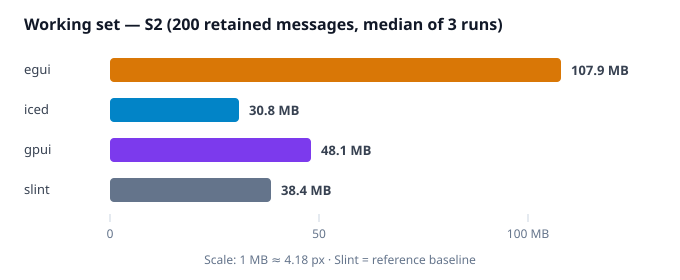
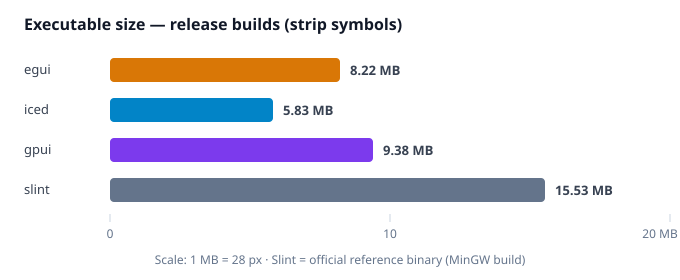

# 基准测试与对比报告

简体中文 | [English](BENCHMARK.en.md)

本报告比较四款程序在同一台机器、同一份配置、同一个本地 Broker 下的内存、CPU、可执行文件体积。
四款程序中的 iced 是本仓库的发布版本，egui / gpui 作为源码内对照，Slint 版是发布前的性能基线。
原始 CSV 与完整明细在本地 `bench/out/`（已被 `.gitignore` 忽略），可用
`tools/bench/run-all.ps1` 一键复现；发布的 Release 不含基准工具与基线程序。

## 1. 测试环境

| 项 | 值 |
|---|---|
| 操作系统 | Windows 11 Pro Workstation 10.0.22631（x64） |
| CPU / 逻辑核数 | AMD Ryzen 7 8845HS，8 核 / 16 线程 |
| 内存 | 31.3 GB |
| 显卡 | AMD Radeon 780M（核显）+ NVIDIA GeForce RTX 4060 Laptop（另有虚拟显示驱动） |
| Rust | 1.98.1 MSVC，`rustc -C target-cpu` 默认 |
| Broker | `tools/test-broker`（内嵌 rumqttd 0.20），`127.0.0.1` |
| 采样 | PowerShell `Get-Process`，1s 间隔；CPU 按逻辑核数归一 |

四个被测程序：

| 程序 | 版本 / 渲染 |
|---|---|
| `mqttc-egui` | egui/eframe 0.37，glow（OpenGL） |
| `mqttc-iced` | Iced 0.14，tiny-skia（软件光栅） |
| `mqttc-gpui` | GPUI 0.2.2，原生 GPU（Direct3D 11，`release-unwind`） |
| `baseline-slint` | 同作者早期 Slint 版 v0.1.1，Slint 1.18.1，软件渲染（仅本地基线，不随仓库分发） |

## 2. 方法

### 2.1 场景

- **S1 启动**：不连接。采样 2s、5s、30s 三个时间点（每款 3 次进程）。
- **S2 连接 + 200 条日志**：Broker 预置 200 条 retained（topic `mqttc/mvp/#`，QoS 0）。
  连接后等 5s 稳定，再连续采样 60s（内存 + 空闲 CPU）。
- **S3 流式接收**：Broker 以 10 msg/s 推送，持续 60s。
- **S4 定时发布**：1 Hz 定时发布，持续 60s。
- 每款程序每个场景 **3 次独立进程**，表中取中位数（内存/CPU）与最大值（峰值/工作集上限）。

### 2.2 指标

- `WorkingSet64`：当前工作集，中位数与最大値。
- `PrivateMemorySize64`：私有提交内存，中位数。
- `PeakWorkingSet64`：进程生命周期峰值。
- `TotalProcessorTime` 差值 / 墙钟 / 逻辑核数 → `CPU%`（表示为整机容量的百分比；
  本机 16 逻辑核，单核满载约为 6.25%）。
- `HandleCount` / `ThreadCount`：采样结束时的快照。
- exe 大小、portable zip 大小；`dumpbin /dependents` 检查系统依赖。
- GPU 显存不在工作集内，未计入；egui/iced 使用系统 OpenGL/软件光栅，GPUI 使用 GPU。

### 2.3 自动化

```powershell
cargo build --release -p mqttc-egui -p mqttc-iced -p mqttc-test-broker
cargo build --profile release-unwind -p mqttc-gpui
powershell -ExecutionPolicy Bypass -File tools\bench\run-all.ps1 -Runs 3 `
    -RetainedPort 1883 -IdlePort 1892 -StreamPort 1893
powershell -ExecutionPolicy Bypass -File tools\bench\baseline.ps1 -Scenario s2 -Runs 3 -Port 1883
powershell -ExecutionPolicy Bypass -File tools\bench\report.ps1 -Out bench\out\tables.md
```

三款新程序以 `--bench --bench-scenario sN --bench-quit-after <secs> --config <fixture>` 启动，
自动连接、订阅、定时发布并按秒退出；脚本在预热后调用 `tools/bench/sampler.ps1` 采样。

早期 Slint 版没有命令行参数：把本地保留的 `mqttc.exe` 复制到 `dist/baseline-slint/`，
在 exe 同目录放置同一份 `mqttc.json`（指向本地 Broker、订阅 `mqttc/mvp/#`），
`baseline.ps1` 用 `SetWindowPos` 固定窗口到 0,0（1712×1109 物理像素），
再通过 `tools/bench/uia-click.ps1` 以客户端坐标点击“连接”（S4 还会点击“定时”），随后采样。
坐标用 `tools/bench/shot.ps1` 截图确认；更换 DPI 或窗口尺寸后需重新确认。
S1/S2/S3/S4 均为 3 次独立进程；S1 在 2s/5s/30s 各取一个快照。

### 2.4 构建配置

| profile | 设置 |
|---|---|
| `release` | opt-level 3、thin LTO、codegen-units 1、strip symbols、panic=abort |
| `release-unwind` | 同 `release`，仅保留 unwind（GPUI 使用） |
| `release-size` | opt-level "s"、fat LTO、其余同 release（仅 egui/iced 附加对照） |

未启用 `+crt-static`；发布包依赖系统 VC 运行库（Windows 10/11 通常已带）。

## 3. 结果

> 数据由 `tools/bench/report.ps1` 从本地 `bench/out/summary.csv` 汇总，每格取 3 次独立进程的中位数，
> 下表按维度重新排版；逐场景完整明细见本地 `bench/out/tables.md` 与原始 CSV（不随仓库分发）。

### 3.1 工作集（Working Set，MB）

| 程序 | S1 2s | S1 5s | S1 30s | S2 200 条 | S3 流式 | S4 定时 |
|---|---|---|---|---|---|---|
| egui | 100.4 | 96.9 | 96.3 | 107.9 | 108.2 | 110.6 |
| iced | **28.8** | **28.8** | **28.8** | **30.8** | **30.8** | **31.2** |
| gpui | 47.1 | 47.2 | 47.4 | 48.1 | 48.1 | 49.0 |
| slint（官方基线） | 32.2 | 32.2 | 32.2 | 38.4 | 39.2 | 35.5 |

相对官方 Slint 基线（S2 38.4 MB）：iced 约 **0.80×**，gpui 约 1.25×，egui 约 **2.8×**。
iced 在全部场景都低于基线；egui 即便空闲也接近 100 MB。



### 3.2 峰值、私有内存、CPU 与句柄

| 程序 | 峰值 WS（最大场景） | 私有内存（最大场景） | 空闲 CPU 中位 | 活跃 CPU 最大 | 线程 | 句柄 |
|---|---|---|---|---|---|---|
| egui | 112.9 MB | 112.9 MB | 0.00% | 0.01% | 12–15 | ≈376 |
| iced | 31.4 MB | 17.5 MB | 0.00% | 0.03% | 9–10 | ≈224 |
| gpui | 55.4 MB | 85.9 MB | 0.00% | 0.00% | 26–28 | ≈1,200 |
| slint（官方基线） | 39.9 MB | 22.3 MB | 0.00% | 0.05% | 7–9 | ≈222 |

> GPUI 的私有提交内存（≈85 MB）明显高于工作集（≈48 MB），线程与句柄数也最多，
> 这是 Direct3D 11 / DComp 运行时的特征；其工作集仍只有 egui 的约 45%。

### 3.3 可执行文件与分发包体积

| 构建 | exe（MB） | portable zip（MB） | 相对官方 Slint exe |
|---|---|---|---|
| `mqttc-egui`（release） | 8.22 | 4.01 | 52.9% |
| `mqttc-egui`（release-size） | 6.43 | — | 41.3% |
| `mqttc-iced`（release） | **5.83** | **2.91** | **37.5%** |
| `mqttc-iced`（release-size） | 4.50 | — | 28.9% |
| `mqttc-gpui`（release-unwind） | 9.38 | 3.75 | 60.4% |
| `baseline-slint`（早期 Slint 版官方 dist） | 15.53 | — | 100% |
| 本地 `bench/ref-build`（同机同 profile 重建） | 14.78 | — | 95.0% |

> 早期 Slint 版官方二进制用 MinGW 工具链构建（依赖 `msvcrt.dll`）；本地 `bench/ref-build`
> 用本机 MSVC 与本仓库相同的 `release` 配置重建，体积仍为 14.78 MB，说明 Slint + 软件渲染
> 的体积基线并不是工具链造成的。`bench/ref-build` 不在公开仓库内。三款新程序中 iced 最小。



### 3.4 渲染与线程

| 程序 | 渲染后端 | UI 刷新策略 | 每连接线程 |
|---|---|---|---|
| egui | OpenGL (glow) | 事件唤醒 `request_repaint` | 1 个 256KB 栈 MQTT 线程 |
| iced | tiny-skia 软件 | 活动时 100ms tick | 同上 |
| gpui | GPU (Direct3D 11) | 活动时 100ms tick / 系统皮肤 1s | 同上 |
| slint | 软件（早期 Slint 版） | 早期版本内置定时器 | 早期版本 |

## 4. 依赖检查

```text
dumpbin /dependents target\release\mqttc-egui.exe
```

`dumpbin /dependents` 结果摘要（完整输出见 `bench/out/dependents.txt`）：

| 程序 | 与 UI 相关的系统 DLL | C 运行库 |
|---|---|---|
| egui | `OPENGL32`、`dwrite`、`dwmapi`、`uxtheme`、`imm32`、`combase` | `VCRUNTIME140` + UCRT api-set |
| iced | `dwrite`（无 OpenGL）、`dwmapi`、`uxtheme`、`imm32` | `VCRUNTIME140` + UCRT api-set |
| gpui | `d3d11`、`dxgi`、`dcomp`、`dwrite`、`comctl32`、`icuuc` | `VCRUNTIME140` + UCRT api-set |
| slint（官方） | `dwrite`、`comctl32`、`dwmapi`（软件渲染，无 GPU DLL） | `msvcrt.dll`（MinGW 构建） |

三者都依赖系统 VC 运行库；Win10 1809+ / Win11 通常已自带。TLS 所需的
`bcrypt`、`crypt32`、`ws2_32` 均为系统 DLL，不额外携带 OpenSSL。

## 5. 结论

以“内存优先、体积其次、空闲 CPU 第三”的排序：

1. **iced 是综合最优**：全部场景工作集 28.8–31.2 MB，比早期 Slint 版基线低约 20%，
   约为 egui 的 28%；exe 5.83 MB、portable zip 2.91 MB，均为最小。
   功能与早期 Slint 版完整对齐，CJK 走系统字体回退。
2. **gpui 居中**：工作集 47–49 MB（约为 egui 的 45%），exe 9.38 MB 最大；
   私有提交内存约 85 MB、句柄约 1,200、线程 26–28，运行时代价明显高于另外两者。
   适合愿意接受 GPU 运行时复杂度、并需要 GPU 动画/文本能力的场景。
3. **egui 内存最差**：空闲即约 100 MB、连接 200 条日志后约 108 MB，约为基线的 2.8×；
   优点是与 eframe 生态成熟、开发效率高。若坚持 egui，可考虑接受这一内存代价。
4. **Slint 基线（早期版本）**：内存 32–39 MB、exe 15.53 MB，介于 iced 与 gpui 之间；
   其软件渲染与紧凑运行时说明“小内存”并非必须依赖 GPU。

空闲 CPU 四者都接近 0%（归一后 ≤0.05%）；活动场景（10 msg/s 接收或 1 Hz 发布）
最高也只有 0.03–0.05%，没有出现需要优化的事件轮询热点。

**结论**：以 iced 作为正式发布版本（Release 只提供它）；egui 作为开发体验/生态备选；
gpui 作为探索性版本，其功能差异见 `docs/PARITY.md`。

## 6. 局限

- 仅在 Windows 11 x64 实测；macOS / Linux 由 CI 构建，未做运行测量与性能采样。
- GPU 显存（GPUI）与驱动常驻不在 `WorkingSet64` 内；egui 的 OpenGL 驱动内存同理。
  因此 GPUI 的“内存优势”仅在进程工作集口径下成立，其私有提交内存反而更高。
- 早期 Slint 版的官方 `mqttc.exe` 为 MinGW 构建；本地 `bench/ref-build` 已用本机 MSVC 和与
  本仓库相同的 `release` profile 重建（仅把资源编译从 windres 换成 Windows SDK 的 `rc.exe`），
  体积 14.78 MB，与官方 15.53 MB 接近。该目录与基线程序均不随公开仓库分发。
- 早期 Slint 版的运行数据依赖 UI 自动化点击，窗口位置/DPI 变化会影响成功率；本次窗口固定为
  1712×1109 物理像素（125% 缩放），点击坐标经截图核对。
- CPU% 按逻辑核数归一（本机 16 线程），单核满载 = 6.25%；表中数值乘 16 即为单核占用比例。

## 7. 外部服务器验证

> 外部服务器与凭据仅保存在本机 `tools/bench/servers.json`（已在 `.gitignore`），
> 不写入本报告、不分发包、不打印到日志。本报告只记录“已验证/未验证”的结论。

| 验证项 | egui | iced | gpui | 早期 Slint 版 |
|---|---|---|---|---|
| MQTT 3.1.1 · 公网 TLS（MQTTS 8883，匿名）连接 / 订阅 | 已验证 | 已验证 | 已验证 | 未验证 |
| MQTT 3.1.1 · 公网用户名密码服务器（MQTT 1883）连接 / 订阅 | 已验证 | 已验证 | 已验证 | 未验证 |
| 受控发布（低速率，单条） | 已验证 | 已验证 | 已验证 | 未验证 |
| 定时发布 / 自动回复各一次 | 定时已验证 | 定时已验证 | 定时已验证 | 未验证 |
| MQTT 5.0 · 公网 TLS 连接 / 发布 / 回投 | 已验证 | 已验证 | 已验证 | 未验证 |

验证方式：`tools/bench/external.ps1` 读取本机 `servers.json`，为每款程序生成临时配置并运行
`--bench`（S2 = 连接+订阅 15s；S4 = 连接+订阅+每 5s 定时发布，共 4 条，并收到 4 条自身回投）。
MQTT 5.0 用 `-Protocol 5.0` 在 TLS 服务器上重复了同样流程。三款程序在两个服务器上均输出
`status=Connected`，TLS 证书按系统根存储校验通过，用户名密码认证连接成功；
发布使用每次运行唯一的 `mqttc/smoke/*` 主题，未做任何压力测试。
自动回复为避免在公共 Broker 产生额外往返，只在本地 Broker 的集成测试中验证。
临时配置与输出位于被忽略的 `bench/out/external/`，不进入分发包。
